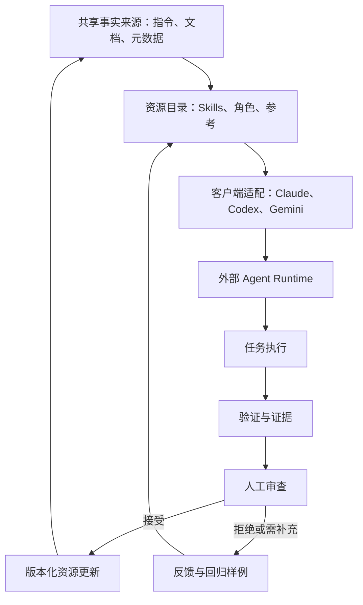
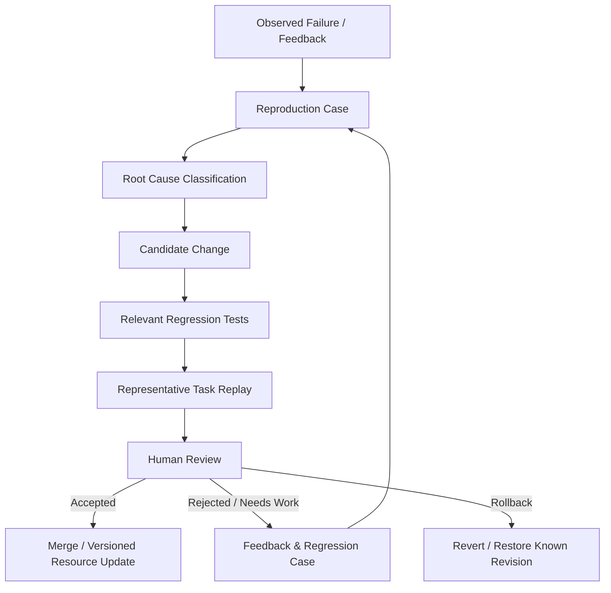

# agent-rsi-infra 设计

本仓库为 AI Infra 开发提供可复用的 Coding Agent 工程规范、Skills、角色与验证工具。目标是让任务有明确依据、执行有适用流程、结果可验证，并把有效反馈沉淀为可审查的改进。

这是设计说明。实际开发要求以 [AGENTS.md](../AGENTS.md) 为准，资源以 [索引](../.agents/README.md) 为准，部署步骤见 [部署说明](deployment.md)。

## 1. 设计目标与范围

| 目标 | 实现方式 |
| --- | --- |
| 规范一致 | 共享要求维护一份，客户端入口引用，不复制业务规则 |
| 上下文精简 | 根指令只放通用要求；按任务读取 Skill 和领域参考 |
| 专业能力可复用 | 保留上游技能的来源、许可与适用边界，按目标项目适配 |
| 验证可信 | 区分静态检查、脚本行为、客户端加载、设备与模型验证 |
| 改进可追溯 | 由失败证据提出最小修正，经审查与验证后纳入仓库 |

仓库维护配置与方法；训练、推理服务、Kernel 和编译器的业务实现仍在目标项目中。MCP 接入、执行权限、远程资源与模型环境由实际运行环境配置。

## 2. 分层与职责

本仓库围绕共享资源与验证证据构建流水线。Agent 的会话、模型调用、工具执行与调度由客户端及目标环境负责。



| 模块 | 本仓库负责 | 由外部环境负责或不默认提供 |
| --- | --- | --- |
| 共享指令 | 通用规则、开发约束与唯一事实来源 | 每个客户端各维护一套重复业务规则 |
| 资源目录 | 技能发现、索引、来源、引用与验证契约 | 所有 Skill 的统一执行引擎 |
| 客户端适配 | 配置生成、路径适配、兼容性回归 | Claude、Codex、Gemini 的 Runtime、会话与模型调度 |
| 验证 | 检查规则、报告校验、回归样例与证据汇总 | 未执行的设备验证、证据真实性背书 |
| RSI 治理 | 候选对照、人工审查、Git 版本记录与恢复约定 | 未经验证自动改写全局规则或自动晋级 |

优先使用静态检查和本地脚本；版本与变更历史由 Git 管理。只有出现真实跨任务协调需求、现有工具无法满足且维护成本可接受时，才评估服务、数据库或通用 Workflow Engine。目录分层不要求每层都成为独立服务。

### 实现落点

| 层次 | 事实来源 | 职责 |
| --- | --- | --- |
| 通用指令 | [AGENTS.md](../AGENTS.md) | 本仓库的开发、环境、验证与提交约定 |
| 客户端入口 | [CLAUDE.md](../CLAUDE.md)、[GEMINI.md](../GEMINI.md) | 导入共享指令，说明客户端适配边界 |
| 任务选择 | [组件与 Skill 路由](component-skills.md) | 按任务和目标框架选择资源 |
| 执行方法 | `.agents/skills/<name>/SKILL.md` | 任务输入、关键操作、验证和交付要求 |
| 角色分工 | `.agents/agents/` | 通用调试与性能分析角色 |
| 自动化 | `scripts/`、`.claude/hooks/` | 可重复检查、事件处理与可选通知 |
| 验证 | `tests/`、`.github/workflows/` | 资源布局、脚本行为和持续检查 |
| 领域知识 | `docs/` | 工程实践、诊断参考与调研依据 |

Instructions 规定约束，Skill 提供方法，角色限定子任务职责，Hook 响应事件，MCP 连接外部工具。它们各自有加载和执行条件，不能仅凭目录存在就认定已生效。

## 3. 目录与客户端适配

```text
agent-rsi-infra/
├── AGENTS.md                  # 共享开发要求
├── CLAUDE.md / GEMINI.md       # 客户端入口
├── CONTRIBUTING.md            # 贡献与改进流程
├── .agents/
│   ├── README.md              # 资源索引
│   ├── agents/                # 通用角色源文件
│   └── skills/                # 共享技能及附属资源
├── .codex/                    # Codex 角色注册与生成配置
├── .claude/
│   ├── agents/                # 生成的 Claude 适配
│   ├── skills -> ../.agents/skills
│   ├── hooks/ / scripts/      # 可选运行资源
│   └── settings.example.json  # 配置模板
├── scripts/check.py           # 本地与 CI 共用检查入口
├── tests/
└── docs/                      # 设计、工程标准与领域参考
```

- **Claude Code**：根入口导入共享指令，通过生成适配使用角色，Skills 使用共享链接。Hooks 和状态栏按需配置，不把示例直接变为活动设置。
- **Codex**：使用根指令与共享 Skills；通过 `.codex/config.toml` 与生成的角色 TOML 接入；共享目录本身不代表角色已加载。
- **Gemini**：提供共享指令入口，实际导入与技能发现需在所用版本确认。

各客户端的逐能力状态维护在 [Agent 能力矩阵](agent-compatibility.md)，按声明、静态检查和真实版本测试区分，不以配置存在宣称已支持。

当前没有专用 Cursor、Copilot 或 MCP 配置。以后增加适配时，先证明真实加载需求，再提供薄入口，不新增一套平行规范。符号链接不受支持的环境按部署说明处理同步。

## 4. Skill 的组织与边界

保持平铺的技能目录，以名称和描述支持发现，用路由及索引表达分类，不为分类改变技能发现路径。

- 通用流程：代码审查、Shell 检查、技能迁入、机械重构验证。
- 跨框架方法：Kernel 微基准、Triton 开发、离线 profiler 分析。
- 框架专项：保留目标框架名称、版本依据、源码路径和依赖，不能将某个项目的内部契约推广为通用规范。

`SKILL.md` 保留适用条件和关键决策；长资料放 `references/`，可复用程序放 `scripts/`，只在确有用途时增加目录。安装外部技能时保留完整资源和许可，来源与本地适配写入 `UPSTREAM.md`。索引不代表每项能力都已完成设备验证。

自动发现与执行授权分开：读取技能不代表允许安装依赖、启动服务、占用 GPU、运行远程任务或发布 PR。保留已有显式调用策略。角色文件只定义分工，是否委派仍由当前任务与运行环境决定。交接输入、输出证据和升级条件见 [Agent 协作契约](agent-collaboration.md)。

## 5. 一次任务如何完成

1. 明确目标仓库、需求、验收条件与授权范围，读取适用的根及目录指令。
2. 检查现有代码、调用路径和测试，再通过路由选择最少的相关 Skills。
3. 在目标项目实施范围内的修改；构建、依赖和运行参数以该项目为准。
4. 按影响验证：本仓库文档与配置检查路径和格式；脚本验证行为；设备、数值或性能变化在对应环境验证。
5. 报告实际改动、命令、结果和未覆盖范围。提交、推送及对外操作按用户授权执行。

性能诊断与正式 benchmark 分开；编译通过、模型能加载、数值正确和性能改善分别需要证据。检查通过不能互相替代。

## 6. RSI：从反馈到受控改进

当前采用轻量治理：Git PR、回归用例、任务契约和人工 Review 足以承载早期候选，不引入通用 Agent Runtime、Workflow Engine、服务或数据库。只有出现大量候选排队、跨项目结果集中汇总等真实需求，才评估自动评测服务；静态检查能完成的工作不引入服务，Git 能记录的版本不急于引入数据库。



根因至少分类为：代码或脚本缺陷、Skill 步骤遗漏或描述不清、客户端加载或版本兼容问题、测试不足或测试不稳定、目标环境/依赖/设备问题、任务定义不充分。分类允许多个，但必须说明证据；环境故障不能伪装为 Skill 缺陷，结构检查也不能伪装为 Agent 效果。

只有同时满足“可复现、可归因、具有重复价值”的问题，才考虑转化为全局规则、Skill 或工具改进。单次偶发失败不直接成为全局 Prompt；单次成功不证明 Skill 有普遍收益。候选接受前需通过固定契约、相关回归和代表性任务回放，保留 baseline/candidate revision、失败对照、成本/退化和未验证项。人工 Review 决定接受、拒绝、继续试验或回滚；工具只汇总状态，不自动改写规则或晋级。

| 阶段 | 产物与判断 |
| --- | --- |
| 记录反馈 | 输入、版本、预期行为、失败日志与复现条件 |
| 建立复现 | 最小可运行案例、固定 revision、资源和评价方式 |
| 分类根因 | 代码/脚本、Skill、客户端、测试、环境或任务定义 |
| 修改候选 | 最小改动及适用范围，不扩展无关规则 |
| 回归与回放 | 相关测试、代表性任务、baseline/candidate 证据 |
| 人工决定 | 接受、拒绝、继续试验或恢复已知 revision |

任务契约与报告格式见[任务与证据规范](task-evidence.md)，候选比较工具只验证结构和状态，不能证明证据真实性。涉及模型和硬件的结论保留原始证据，变更历史通过 Git 追溯。具体贡献流程见 [贡献要求](../CONTRIBUTING.md)。

任务报告由 `scripts/validate_task_result.py` 检查格式和可选契约匹配；候选由 `scripts/compare_task_results.py` 汇总状态变化；延迟测量由 `scripts/validate_benchmark.py` 检查记录并计算统计。这些工具不调度 Agent、不验证日志真实性、不自动批准候选。[任务与证据规范](task-evidence.md)记录协议及建设状态。

## 7. 验证与后续演进

当前检查入口是 `python3 scripts/check.py --check`，配合 pre-commit、相关回归和技能结构检查。它验证仓库自身的布局与工具行为，不证明所有客户端、目标框架或设备上的能力。

后续按实际任务推进：先修复发现、链接、授权或验证中的具体问题，再增加缺失能力。只有重复任务证明有价值时，才建设任务样例与改进前后对照；只有出现新的客户端需求时，才新增适配。每项扩展都应说明适用任务、验证方式和维护成本，避免以技能数量或配置数量作为成果指标。

## 8. 实践标准的落地

| 标准 | 本仓库落点 | 验证边界 |
| --- | --- | --- |
| 共享规范与分层加载 | 根指令、任务路由、通用角色及客户端适配 | 布局、引用与生成一致性；客户端加载单独核实 |
| Python 工程治理 | Ruff、pytest、pre-commit 和统一检查入口 | pytest 兼容已有 unittest 用例，不要求为迁移改写断言 |
| 多语言与编译器治理 | 框架专项 Skills 与领域验证指南 | 本仓库无业务 C++/CUDA 源码；在目标项目沿用 clang-format、构建和 API 检查 |
| 正确性与性能分离 | reference/回归、模型评估、独立 benchmark | 文档检查不外推为模型质量或硬件性能证据 |
| 审查与责任 | 只读 code-reviewer、提交前自查及人工 Review | Agent 输出辅助判断，人类作者理解、验证并承担提交责任 |
| 受控 RSI | 失败证据、最小修正、代表性对照与审查 | 不自动改写规则，不以一次成功晋级，不按技能数量衡量改进 |

环境优先使用项目已选定的 Python；建议在 `.venv` 中安装开发依赖，可使用 uv 管理。缺少解释器或工具时明确报告，不全局安装。分布式和模型验证记录设备、节点、并行策略、启动命令及配置；快速检查与昂贵验证分开报告。标准原文见 [工程实践标准](engineering-standards.md)。

## 9. 落地路线图与验收标准

按阶段验收，不以文件存在或测试数量判断完成。当前工程底座已有实现，但仍有检查覆盖与真实加载证据缺口；Phase 1 尚未形成真实任务集，Phase 2 未启动。

### Phase 0：工程底座

目标：让现有能力可检查、可追溯、可复现。

| 工作项 | 交付物与当前落点 | 验收标准与剩余缺口 |
| --- | --- | --- |
| Skill Contract | `scripts/check_skills.py`、`tests/test_skills.py` | 检测重名、损坏 Frontmatter、死链接和索引漂移；自由文本中的脚本路径与解释器/权限仍需补充验证，不能宣称已全部覆盖 |
| Validation Report | [状态与模板](task-evidence.md#validation-report-状态与模板)及 JSON 校验器 | 明确区分通过、失败、跳过、阻塞、未运行、不适用；Markdown 的详细状态与现有 JSON 状态需按规则映射 |
| Check Runner 回归 | `scripts/check.py`、`tests/test_checks.py` | 失败后继续、完整失败汇总、退出码、fix 后完整复查、超时、缺依赖和非根目录调用均有行为测试；继续补充子进程启动异常等缺口 |
| Installer 安全回归 | `tests/test_skill_installer.py`、`tests/test_github_utils.py` | 路径越界、符号链接、目标冲突、部分失败回滚有回归；网络与凭证边界按实际覆盖报告，不以现有用例声称安全穷尽 |
| 客户端兼容矩阵 | [能力与验证矩阵](agent-compatibility.md) | 声明、静态检查、真实客户端验证分开；真实测试绑定精确版本、revision 和日志，目前真实加载仍为 not-tested |

**完成标志**：普通 PR 的 CI 能自动检查仓库内部规范和资源结构，以上行为验收均有证据；所有客户端/Skill 能力声明都有对应验证状态与边界。真实客户端未测可以如实保留 not-tested，不能把文件存在写成已支持。当前不宣布 Phase 0 全部完成。

### Phase 1：AI Infra 回归与实验可复现

目标：用真实任务衡量 Skill 价值。

| 工作项 | 交付物 | 验收标准 |
| --- | --- | --- |
| 黄金任务集 | 3—5 个代表性任务及脱敏输入、契约、执行记录 | 每项固定输入、目标 revision、测试命令、资源要求和结果证据；模板、合成数据不计为真实任务 |
| Benchmark 元数据 | [性能与环境规范](task-evidence.md#性能与环境)及记录校验 | 代码、硬件、软件、负载、测量方法和原始结果可关联；当前 latency 校验器仍需真实硬件记录验证 |
| 领域验证映射 | [领域工程实践](ai_infra_agent.md)与[任务路由](component-skills.md) | 训练/RL/推理/Kernel 变更均能选择最低有效检查及按影响增加的验证；逐类用真实任务复核 |
| Skill 效果评估 | 人工评估记录、固定契约和候选比较结果 | 同一任务集可比较成功率、证据完整率、成本、退化；分母、预算、重复次数和未执行项明确，不仅比较报告结构 |

**完成标志**：能回答“哪个 Skill revision，在什么客户端精确版本和环境下，对哪些任务有效，有什么收益或退化”。记录任务、输入、Skill、客户端适配和目标代码各自的版本；不得将目标代码优化效果直接归因为 Skill 改进。

效果评估先约定各任务的通过条件与必要证据：成功率为通过任务数/固定任务总数，证据完整率为具备可复核证据的必需项数/必需项总数，回归率为基准通过而候选失败的条目数/基准通过条目数。未运行项保留在总量中并单列，分母为零时记不适用；成本记录耗时、设备时间及可获得的费用。比较前固定口径，避免事后调整门槛。

### Phase 2：受控 RSI 自动化

目标：减少人工整理和比较成本，保留人工治理。

可按实际瓶颈增加：从失败报告提取候选回归用例、辅助识别重复问题、在固定任务集比较 Skill 版本、生成候选 PR 与 Validation Report、按质量门禁给出建议，以及为退化候选保留回滚路径。创建 PR 等对外操作仍遵循任务授权；自动化不直接改写主分支规则或替代人工批准。

**启动条件**：Phase 1 已有可重放的真实任务及多次候选评估，人工排队或汇总成本有记录且已成为瓶颈。先由人工评审瓶颈证据、自动化范围、成本、回滚方式和维护责任，再选择最小实现；没有这些需求时不建设独立服务或数据库。

候选接受须满足第 6 节的回归、代表性回放和人工审查要求。拒绝和回滚同样保留原因、失败证据与关联 revision，不以自动生成 PR 数量作为 RSI 成效。
