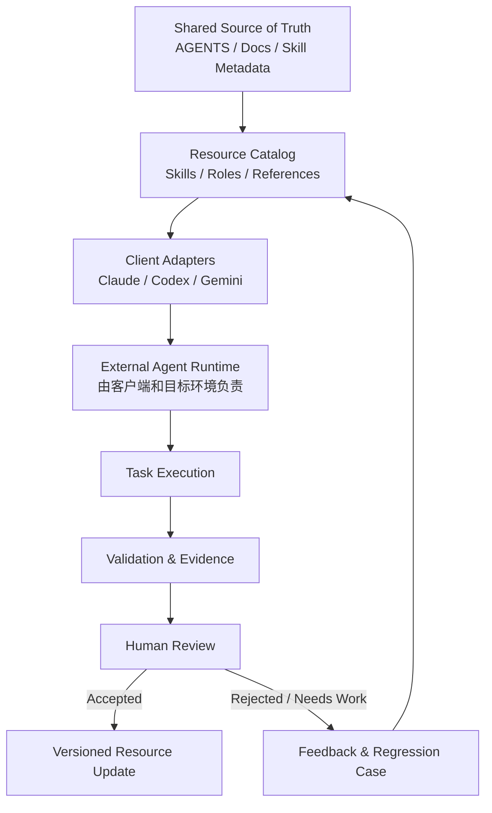

# `agent-rsi-infra` 架构与工程质量优化建议

> **评审对象**：[`jianzhnie/agent-rsi-infra`](https://github.com/jianzhnie/agent-rsi-infra)  
> **评审日期**：2026-11-25  
> **评审范围**：仓库公开 `main` 分支上的 README、架构设计、共享指令、部署与贡献文档、Python 工程配置、核心检查脚本及代表性 Skills。  
> **评审方式**：基于公开代码与文档的静态审阅；未在本地克隆仓库、未执行仓库测试、未实际启动 Claude Code/Codex/Gemini、未连接 GPU 或真实模型环境。

---

## 1. 执行摘要

### 1.1 总体判断

`agent-rsi-infra` 当前更准确的定位是：**面向 Coding Agent 的 AI Infra 工程规范、Skills、客户端适配与验证流程仓库**。它不是一个负责运行 Agent、调度 GPU、执行训练或管理推理服务的 Runtime，也尚不是具备自动评测、自动晋级和自动改写规则能力的 RSI 服务平台。

这个定位是合理的。仓库的设计文档已经明确划分了共享指令、客户端入口、任务路由、Skills、角色、Hook、验证和领域知识的职责；也明确说明当前 RSI 通过失败证据、最小修正、回归验证和人工审查实现，尚无自动评测、晋级或规则改写服务。建议继续沿着轻量、可组合、可验证的方向演进，不宜为了“平台化”过早引入常驻服务、数据库、复杂插件总线或新的 Agent Runtime。

### 1.2 最值得优先投入的方向

| 优先级 | 建议 | 价值 | 建议复杂度 |
|---|---|---|---|
| P0 | 建立统一的任务结果与验证证据格式 | 让不同 Agent、Skill 和 AI Infra 工作流的结果可比较、可追溯 | 低—中 |
| P0 | 完善 Skill 元数据、资源引用和客户端适配回归 | 降低 Skill 漂移、加载失败和文档索引不一致 | 中 |
| P0 | 补齐检查脚本和安装器的边界行为测试 | 提升仓库自身工具的可靠性 | 中 |
| P1 | 建立真实 AI Infra 任务的回归样例集 | 验证 Skill 是否真正改善任务结果 | 中—高 |
| P1 | 形成 Benchmark 结果与环境指纹规范 | 让性能优化结论可复现 | 中 |
| P2 | 引入候选改进评估和人工晋级流程 | 逐步形成受控 RSI 闭环 | 高 |

**最核心的建议：先建立“任务契约 + 验证报告 + Skill 回归测试”，再考虑自动化 RSI。** 这三个基础构件比继续增加 Skills 数量或重构目录更能改善长期质量。

### 1.3 本次评审的关键修正

不建议把仓库直接重构成一个通用 Agent 平台，也不建议将当前 61 行左右的 `scripts/check.py` 拆成多层插件框架。现有脚本体量小、执行顺序清晰，应该先补充可测试性和诊断能力；当检查项和实现复杂度真实增长后，再考虑模块拆分。

另外，仓库已有不少良好实践，包括统一 `AGENTS.md` 来源、客户端薄入口、外部 Skill 来源和许可证记录、失败后继续检查、区分静态/数值/设备/性能验证等。建议是在这些基础上补齐自动化证据，而不是重复建设已经存在的规范。

---

## 2. 当前仓库现状与已有优势

### 2.1 仓库职责边界比较清晰

从 [README](https://github.com/jianzhnie/agent-rsi-infra/blob/main/README.md)、[RSI_DESIGN.md](https://github.com/jianzhnie/agent-rsi-infra/blob/main/docs/RSI_DESIGN.md) 和 [AGENTS.md](https://github.com/jianzhnie/agent-rsi-infra/blob/main/AGENTS.md) 可以确认：

- `AGENTS.md` 是共享开发指令的唯一来源。
- `CLAUDE.md`、`GEMINI.md` 等文件主要承担客户端入口和适配说明，而不是复制完整规范。
- `.agents/skills/` 是共享 Skills 的主要来源；Claude 的 Skills 通过链接复用共享内容。
- `.agents/agents/` 保存通用角色源文件，客户端侧保存相应适配。
- `.codex/`、`.claude/` 负责不同客户端的注册、配置和运行适配。
- `scripts/`、`tests/` 与 `.github/workflows/` 承接本仓库工具和配置的验证。
- 训练、推理、Kernel 和编译器的业务实现仍属于目标项目，而非本仓库。

这种拆分避免把“指导 Agent 如何开发 AI Infra”与“实现 AI Infra 业务”混在一起，是值得保留的架构决策。

### 2.2 Skills 已覆盖一批有实际价值的领域工作流

当前资源索引包括代码审查、调试、性能分析、Skill 迁移、Shell 检查、PyTorch 2 编译器排障、类型检查、Kernel 微基准、Triton 开发、vLLM 模型部署与微基准、SGLang 分布式挂起诊断、Profiler Trace 分析、Kernel 组织、KL 一致性测试，以及训练/推理变更流程等。

其中，`training-inference-change` 已经要求先定义变更契约、确认真实代码路径、选择最低有效验证，并明确报告设备和未执行项；`shell-check` 已经处理文件名中的空格和换行、逐项失败后继续、缺少 ShellCheck 时区分跳过与通过；`install-skill-from-github` 则明确区分迁入和执行，不会因为安装 Skill 就自动安装第三方工具或执行下载脚本。

这些实践说明仓库已经超出“Prompt 集合”的范畴，具备了一定的工程流程资产。

### 2.3 Python 工程基础配置适度且明确

[`pyproject.toml`](https://github.com/jianzhnie/agent-rsi-infra/blob/main/pyproject.toml) 当前包含：

- Python `>=3.10`。
- Ruff 格式化与 lint，包含 Pyflakes、pycodestyle、Import 排序、Bugbear、Comprehensions、Simplify、Pyupgrade 和未使用 `noqa` 检查。
- Pytest 测试发现规则和严格 marker。
- `slow`、`integration` 测试标记。
- `dev` 可选依赖：pytest、ruff、pre-commit。
- 包本身无运行时依赖，`setuptools` 配置也表明 Python 安装主要用于开发依赖管理，Agent 资源仍从 Git 工作区使用。

这种轻依赖策略与仓库定位一致，不建议为了“看起来完整”加入大量运行时依赖。

### 2.4 检查入口和外部 Skill 安装器已有可靠性设计

[`scripts/check.py`](https://github.com/jianzhnie/agent-rsi-infra/blob/main/scripts/check.py) 目前串行执行 Ruff lint、格式检查、Pytest 和 Shell 检查；支持 `--check` 与显式 `--fix`；修复后会再次执行完整验证；单项失败后继续执行剩余检查并汇总失败项。它使用参数列表执行子进程，而不是默认拼接 Shell 命令，并处理命令无法启动的 `OSError`。

[`install-skill-from-github.py`](https://github.com/jianzhnie/agent-rsi-infra/blob/main/.agents/skills/install-skill-from-github/scripts/install-skill-from-github.py) 已包含多项值得保留的保护：

- 仅接受 GitHub HTTPS 下载 URL。
- 校验 Skill 相对路径和命名规则。
- 解压 ZIP 前检查路径是否越出目标目录。
- 拒绝 Skill 目录内不受支持的符号链接和文件类型。
- 为 Git 子进程设置超时，并关闭交互式凭据提示。
- 目标目录已存在时拒绝覆盖。
- 批量安装前先准备和验证资源，失败时回滚本次创建的目录。
- 生成 `INSTALL_SOURCE.json`，尽可能记录解析后的 commit。

因此，安全方面更应优先建设**针对已有防护措施的回归测试**，而不是再加一套重复的抽象安全层。

### 2.5 当前 CI 与实际验证边界

README 记录的 CI 验证矩阵包括 Linux/Python 3.10、Linux/Python 3.13 和 macOS/Python 3.13。该信息可以说明预期覆盖范围，但本次评审没有核验 GitHub Actions 对最新提交的实时运行结果，也没有实际执行这些任务。

设计文档已经明确：目录存在、链接有效与客户端真实加载是不同的验证范围；本仓库检查通过也不能证明目标项目、GPU、模型或性能行为正确。这个边界意识很好，建议继续强化为机器可读的验证结果。

---

## 3. 架构设计优化建议

## 3.1 保持轻量架构，不要过早引入 Agent Runtime

当前更合适的架构不是“Agent Core + 大量服务”，而是围绕共享资源和证据构建一条可验证流水线：



建议明确以下架构边界：

| 模块 | 本仓库应负责 | 不应默认承担 |
|---|---|---|
| Shared Instructions | 通用规则与开发约束 | 每个客户端的完整重复规则 |
| Skill Catalog | 技能发现、索引、来源和验证契约 | 所有 Skill 的统一执行引擎 |
| Client Adapter | 配置生成、路径适配、兼容性验证 | 替代 Claude/Codex/Gemini 自身 Runtime |
| Validation | 检查规则、报告格式、回归样例和证据汇总 | 无 GPU 环境时伪装完成 GPU 验证 |
| RSI Governance | 候选改动、人工评审、版本记录和回滚约定 | 未经验证自动修改全局规则 |

**建议原则：能由静态检查完成的，不引入服务；能由 Git 管理的，不急着引入数据库；没有真实跨任务协调需求，不实现通用 Workflow Engine。**

## 3.2 定义轻量 Task Contract

当前 Skill 已经在自然语言中要求任务明确目标、目标仓库、输入、约束、验证范围和交付证据。建议将高频且反复出现的字段整理成一个轻量任务模板，供 Benchmark、跨 Agent 回归和复杂任务使用，而不是要求每个普通文档任务都必须创建 YAML 文件。

建议模板：

```yaml
schema_version: 1

task:
   id: triton-attention-optimization
   domain: kernel
   objective: reduce_latency

 target:
   repository: upstream-project
   revision: <git-sha>
   component: attention_kernel

 workload:
   shapes: [[128, 4096, 128]]
   dtypes: [bf16]
   devices: [<gpu-model>]

 constraints:
   correctness_required: true
   max_runtime_seconds: 1800
   max_gpu_count: 1

 validation:
   required: [compile, numerical_reference, benchmark]
   optional: [multi_shape, model_integration]

 acceptance:
   metric: latency_p50_us
   direction: minimize
   threshold: project-defined
```

说明：

- 这里的 YAML 是提议的模板，不代表当前仓库已有该 Schema。
- `domain` 可用于选择训练、RL、推理、Kernel 或编译器专属约束。
- 资源权限应继续遵守实际客户端和运行环境授权；Task Contract 中的声明本身不能替代运行时权限控制。
- 不要把所有 AI Infra 任务压成同一种字段集。通用字段保持少量，领域字段按需扩展。

## 3.3 统一 Skill 的“最小契约”，但不要破坏上游原文

当前不同来源的 Skill Frontmatter 存在合理差异：有的只有 `name`、`description`、`license`，有的附带版本、作者、平台和 tags。由于仓库有意保留上游内容和元数据，不建议强制所有迁入 Skill 改写成同一种 Frontmatter。

建议采取两层治理：

**层 A：最低可发现性契约**

- `name` 存在且唯一。
- `description` 非空，说明适用任务和不适用范围。
- `SKILL.md` 路径有效。
- 相对引用存在。
- 必须明确说明必要验证和交付证据；若上游内容没有该信息，可在本地适配文档补充。

**层 B：可选扩展元数据**

- `version`、`author`、`license`、`platforms`、`tags`、`related_skills`。
- `requires` / `preconditions`：依赖和前置条件。
- `validation`：正确性、设备、模型或性能验证要求。
- `risk_level`：仅用于帮助审查，不等同于运行权限。

推荐 Skill 最低正文契约：

```markdown
# Skill Title

## When to use
适用场景与排除场景。

## Inputs / Preconditions
需要的代码、版本、环境、reference 和设备。

## Workflow
主要诊断或实现步骤。

## Validation
必须执行的检查、按需执行的检查以及失败处理。

## Deliverables
命令、结果、日志、版本、设备和未验证项。
```

建议增加 `check_skills.py` 或在现有检查入口中增加 Skill 检查阶段，覆盖名称重复、Frontmatter 可解析性、资源引用、相对路径、缺失章节和索引完整性。对完整保留的上游 Skill，可以采用例外清单或本地侧车元数据，不要为了 schema 统一而改坏原始许可和上游语义。

## 3.4 建立 Agent Capability Matrix，并记录“实际验证状态”

仓库已经提醒：目录布局不能证明客户端完成加载。建议把这一点进一步变成维护资产，例如 `docs/agent-compatibility.md`：

| 客户端 | 共享指令 | Skills 发现 | 角色加载 | Hooks | 最近验证版本 | 状态 |
|---|---|---|---|---|---|---|
| Claude Code | 入口导入 | 实际客户端验证 | 生成适配验证 | 可选，独立验证 | 精确版本号 | tested / not tested |
| Codex | 根指令 | 实际客户端验证 | TOML 配置验证 | 不适用或另行说明 | 精确版本号 | tested / not tested |
| Gemini | 导入语法验证 | 发现机制待核实 | 按实际能力填写 | 按实际能力填写 | 精确版本号 | tested / not tested |

状态建议只使用：

- `declared`：仓库提供了对应配置或入口。
- `static-checked`：路径、格式和引用已检查。
- `client-tested`：在明确版本的真实客户端中测试过。
- `not-tested`：尚未验证。
- `unsupported`：明确不支持。

每次客户端适配变更时，先运行静态检查，再由真实客户端执行最小加载 Smoke Test。Smoke Test 应验证指令导入、Skill 发现、角色可用和必要 Hook 行为；不应把仅仅存在一个文件写成“已支持”。

## 3.5 统一 Validation Report：这是最应优先建设的架构构件

目前文档已经要求 Agent 报告准确命令、结果、设备拓扑和未执行项，但不同 Skill 的输出结构仍可能不同。建议定义一个非常轻量的统一 Validation Report，既可供人工阅读，也方便后续脚本解析。

推荐字段：

```yaml
schema_version: 1

task:
  id: triton-attention-optimization
  domain: kernel
  target_revision: <git-sha>

agent:
  client: codex
  client_version: <version>
  skill: kernel-microbenchmark

environment:
  os: linux
  python: <version>
  framework: <version>
  cuda_runtime: <version>
  driver: <version>
  gpu: <model>

checks:
  - name: compile
    status: passed
    command: <exact-command>
  - name: numerical_reference
    status: passed
    artifact: artifacts/correctness.json
  - name: performance
    status: not_run
    reason: GPU environment unavailable

overall:
  status: partial
  limitations:
    - Performance was not measured
  reviewer_decision: pending
```

`status` 建议区分 `passed`、`failed`、`skipped`、`blocked`、`not_run`、`not_applicable`。尤其不能把未运行、环境不足或不适用写成通过。

报告应绑定目标仓库的 Git commit、Agent/Skill 版本和测试环境。性能结果还应关联原始输出文件、命令和输入配置。这样才能避免候选代码发生变化后仍错误复用旧 benchmark。

## 3.6 RSI 改进先采用 PR 驱动，不急于自动晋级

现有 RSI_DESIGN 已明确当前没有自动评测、晋级或规则改写服务。建议分阶段实现：

```text
Observed Failure / Feedback
  -> Reproduction Case
  -> Root Cause Classification
  -> Candidate Change
  -> Relevant Regression Tests
  -> Representative Task Replay
  -> Human Review
  -> Merge / Reject / Rollback
```

根因分类建议至少区分：

- 代码或脚本缺陷。
- Skill 步骤遗漏或描述不清。
- 客户端加载或版本兼容问题。
- 测试不足或测试本身不稳定。
- 目标环境、依赖或设备问题。
- 任务定义不充分。

只有可复现、可归因、具有重复价值的问题，才应该转化为全局规则或 Skill 改进。单次偶发失败不能直接成为全局 Prompt；单次成功也不能证明 Skill 有普遍收益。

初期使用 Git PR、回归用例和人工 Review 就足够。只有出现大量候选需要排队评估、跨项目任务结果需要集中汇总等真实需求后，再考虑自动评测服务或数据库。

---

## 4. 代码规范与代码质量

## 4.1 保持 `scripts/check.py` 简单，先补能力而非先拆模块

当前 `scripts/check.py` 只有约 61 行，责任是组织检查执行顺序和汇总退出码，尚未表现出必须拆成框架的复杂度。建议保留单一入口，逐步补充以下能力：

1. **超时处理**：对子进程设置可配置超时，捕获 `TimeoutExpired`，明确报告超时的检查项。
2. **依赖检查**：在执行前检查 Ruff、Pytest、Bash、ShellCheck 等必要命令是否可用；缺少可选工具应区分 `blocked` / `skipped`，不能误报通过。
3. **单项执行能力**：可选支持 `--only lint,tests` 或等价参数，缩短日常调试时间；CI 仍执行完整入口。
4. **结构化结果**：在保持人类可读日志的基础上，按需增加 JSON 或 JUnit 输出，供 CI 汇总和后续 RSI 统计使用。
5. **执行上下文**：报告当前工作目录、Python 可执行文件、工具版本和实际运行命令。

建议的最小返回结构：

```python
from dataclasses import dataclass

@dataclass
class CheckResult:
    name: str
    status: str  # passed / failed / blocked / skipped
    return_code: int | None = None
    duration_seconds: float | None = None
    message: str | None = None
```

不要立即引入通用插件注册机制。等检查实现明显增长到多个独立模块，并出现复用或并行执行需求，再拆为 `scripts/checks/`。

## 4.2 为检查编排器增加行为测试

检查脚本本身是这个仓库的关键基础设施，应验证行为而不只是验证文件内容。优先覆盖：

- 所有检查成功时返回 0。
- 一个检查失败后，后续检查仍继续执行。
- 多个检查失败时，汇总列表完整。
- 子进程启动失败时，报告对应命令并继续执行。
- 子进程超时后状态正确，不挂住整个流程。
- `--check` 不修改工作树。
- `--fix` 修改后会重新运行全部必要检查。
- 从非仓库根目录调用时仍使用正确的 repo root。
- 工具缺失时区分缺失依赖和检查失败。

建议使用临时 Git 仓库、可替换 PATH 的假命令或 mock subprocess，避免依赖真实网络、桌面通知或 GPU。仓库现有测试隔离思路可以沿用。

## 4.3 为 Skill Installer 建立安全边界回归

安装器已经有路径校验、符号链接限制、ZIP 解压校验、目标冲突拒绝、临时目录和回滚逻辑。下一步是用恶意或异常输入验证这些逻辑确实有效：

- ZIP Slip：文件名包含 `../` 或绝对路径。
- Skill 内部符号链接指向目录外。
- 缺少 `SKILL.md` 或目标路径类型不正确。
- 多个来源中有一个无效时，不留下部分安装结果。
- 目标目录已存在时不覆盖原有数据。
- 上游资源包含保留文件名 `INSTALL_SOURCE.json` 时安全失败。
- 下载失败、Git 超时或鉴权失败时错误消息不泄露 Token。
- 可变分支无法解析 commit 时，报告不声称这是固定快照。
- 带空格、非 ASCII 字符和边界路径在不同平台下行为符合预期。

建议补充对 `github_utils.py` 的 URL、HTTP 错误、凭证脱敏和超时测试。不要为了测试安装器而真正运行下载来的脚本。

## 4.4 Skill 资源完整性检查

建议在 `check.py` 的统一入口中增加或调用 Skill Contract 检查器，覆盖：

- YAML Frontmatter 结构可解析，`name` 唯一且符合命名规范。
- Skill 文件目录名、Frontmatter 名称和资源索引一致。
- Markdown 相对链接和脚本路径都存在。
- 脚本有可执行权限或文档使用正确的解释器调用方式。
- 共享 Skill 没有错误引用客户端私有目录。
- 生成的客户端适配能由源文件重新生成，避免手工修改生成文件造成漂移。
- `INSTALL_SOURCE.json`、`UPSTREAM.md`、LICENSE、NOTICE 之间的来源信息没有明显冲突。

不建议单纯为了增加测试数量而给每个 Markdown 文件做快照测试。测试重点应放在路径、元数据、资源引用、生成和加载这些真实行为上。

## 4.5 明确来源元数据的职责

当前仓库使用 `INSTALL_SOURCE.json` 记录安装过程中的机器可读来源信息，也使用 `UPSTREAM.md` 记录上游版本、本地适配、许可和复核边界。这两者可以共存，但文档应清楚定义：

- `INSTALL_SOURCE.json`：安装器生成的来源快照，侧重仓库、路径、请求 ref 和 resolved commit。
- `UPSTREAM.md`：人工维护的适配说明，侧重本地改动、许可证、验证边界和后续同步说明。

不要在两个文件中维护互相矛盾的版本事实。可以由检查脚本读取 `INSTALL_SOURCE.json`，并检查 `UPSTREAM.md` 中的来源链接是否存在；不必立即设计复杂的供应链数据库。

## 4.6 继续使用 Ruff 和 Pytest，按真实代码量逐步加门禁

当前 Ruff 规则覆盖面已经足以支撑现有小规模 Python 工具。建议继续遵守：

- 以 `pyproject.toml` 为唯一 Ruff 配置来源。
- 不额外叠加 Black、isort 等重复配置。
- Python 最低版本和 Ruff target 保持一致。
- 对运行时代码使用显式异常进行输入校验，不依赖 `assert`。
- 仅当代码规模、类型复杂度或公共 API 扩大时，再考虑 Mypy/Pyright 或更严格的类型检查。
- Python 与 Shell 分别执行相应静态检查，不要为仓库没有的 C++/CUDA 业务代码添加空门禁。

README 记录的 CI 覆盖 Python 3.10 与 3.13，但项目声明支持 3.10—3.13。可以评估是否增加 3.11、3.12 的 Linux 兼容性覆盖；不必在每个系统上都跑完整矩阵。Windows 是否纳入正式支持，应先决定符号链接、Shell 环境和部署方案，再增加对应 CI。

---

## 5. AI Infra 领域验证体系

这里是仓库区别于通用 Coding Agent 模板的核心价值。当前 `docs/ai_infra_agent.md` 已经覆盖训练、RL、推理、多模态、Kernel 和编译器的验证要点。建议后续不要再重复写大段通用指南，而是把现有要求沉淀为可复用的任务样例和结构化结果。

## 5.1 按领域选择验证，不要为所有任务强制跑全部层级

| 领域 | 基础验证 | 按影响追加验证 | 重要证据 |
|---|---|---|---|
| 训练 | 导入、配置、forward、loss | 梯度、多步训练、checkpoint 保存/恢复、并行和多节点 | loss/gradient、checkpoint、rank 拓扑、训练配置 |
| RL / Rollout | 数据结构、token/logprob 对齐、reward/verifier 行为 | 多轮交互、异步流程、权重同步、长时间运行 | 采样参数、rollout 轨迹、reward 分布、权重版本 |
| 推理服务 | 模型加载、API、请求/响应、配置 Schema | KV Cache、调度、并发、长上下文、故障恢复、端到端评估 | 模型版本、请求配置、TTFT/TPOT、吞吐和尾延迟 |
| 多模态 | 各 Stage 输入输出协议、shape/dtype/device | 流式顺序、背压、取消、资源释放、音画同步 | Stage 事件、时间戳、流式间隔、端到端结果 |
| CUDA / Triton Kernel | 编译、reference 数值对比、shape/dtype/stride 边界 | 梯度、竞态/越界、不同架构、模型集成、性能 | 误差、输入 shape、GPU/工具链、原始 benchmark |
| 编译器 | IR/语义回归、编译与执行 | 多 Target、代码生成、ABI/API、端到端模型行为 | IR 快照、target、编译器版本、执行结果 |

重要原则：**验证范围随变更影响选择**。文档编辑不应该要求 GPU 测试；CPU 导入成功也不能被描述为 GPU 正确；Kernel 微基准通过不代表模型端到端行为没有变化。

## 5.2 统一 Benchmark 记录格式

建议先统一结果字段，再考虑统一 Benchmark Runner。不同项目可能使用 vLLM、SGLang、PyTorch Profiler、Triton、NCCL 或自定义脚本，不应强制用同一套命令或同一工具。

Benchmark 结果至少记录：

| 类别 | 字段 |
|---|---|
| 代码 | baseline commit、candidate commit、相关模型/依赖 revision |
| 环境 | GPU 型号与数量、驱动、CUDA、框架、编译器、容器或环境标识 |
| 负载 | shape、dtype、batch、序列长度、并发、数据集/请求配置 |
| 方法 | warmup、重复次数、同步与计时方式、缓存条件、统计方法 |
| 结果 | 绝对延迟、吞吐、显存、分位数、波动和退化项 |
| 产物 | 完整命令、原始日志、结果文件、配置快照 |

指标应按任务选择：

- 训练：step time、tokens/s、峰值显存。
- 文本推理：TTFT、TPOT、吞吐、p50/p95/p99 延迟。
- 多模态：首包延迟、端到端延迟、实时率、流式间隔或同步误差。
- Kernel：绝对延迟、带宽/显存等与该算子相关的指标，以及覆盖的 shape。

不要预设统一的 3% 或 5% 性能门槛。不同硬件、算子和测量噪声差异很大。验收阈值应由任务配置和重复测量决定，并记录波动；对共享 GPU 环境的测试，应说明资源干扰。

## 5.3 建立小而精的黄金任务集

优先挑选少量高频、具有代表性且可复现的场景，例如：

1. 一个 Triton Kernel 的数值正确性 + 微基准任务。
2. 一个 vLLM 模型前向 Benchmark 任务。
3. 一个 SGLang 多卡挂起诊断任务。
4. 一个 checkpoint 保存与恢复任务。
5. 一个 Skill Installer 的失败回滚任务。

每个用例都应有固定输入、初始版本、预期结果、验证命令和证据模板。可在未来比较不同 Skill 版本、Agent 客户端和模型配置的表现。

评价指标建议包含：

- 任务完成率，而不是只看 Agent 是否返回文本。
- 正确性通过率和回归失败率。
- 验证证据完整率。
- 错误结论率（未验证却声称通过）。
- 平均执行时长、Token/调用成本和 GPU 成本。
- 跨 Agent 的兼容性差异。

任务集初期可以由人工运行和记录，不必马上实现在线评分服务。

---

## 6. 安全、权限与供应链治理

### 6.1 区分“Skill 声明能力”与“Runtime 实际权限”

Skill 文档可以说明需要访问 GPU、网络、文件系统或远程集群，但文档声明本身不授予权限。实际授权仍由用户、Agent 客户端、Sandbox、容器和目标环境负责。

建议每个高风险 Skill 明确列出：

- 可能执行的副作用，例如安装依赖、删除文件、启动服务、访问网络、调用远程集群。
- 需要用户显式确认的步骤。
- 默认禁止的行为，例如自动推送代码、覆盖用户配置、执行下载来的未知脚本。
- 失败和清理行为。

不要在仓库内部制造一套看似强制、但实际无法拦截客户端操作的“权限系统”。应明确哪些约束只是文档策略，哪些由脚本真实 enforce，哪些必须由 Runtime enforce。

### 6.2 外部 Skill 供应链

当前贡献指南已经要求记录来源 URL、revision（优先完整 commit SHA）和 license，并保留版权声明、LICENSE 和 NOTICE。安装器也会生成来源信息并避免执行下载脚本。

建议继续加强：

- 对可变分支迁入的 Skill 标注 `resolved_commit` 是否可确认。
- 重要 Skill 固定上游 SHA，定期进行人工或自动差异检查。
- 对本地 patch 记录原因和适用范围，不直接覆盖上游内容。
- 对脚本权限、外部网络访问、凭证处理和破坏性命令进行审查。
- 对安装器的归档解压和回滚逻辑保持自动化安全回归。

### 6.3 日志与凭证

统一规定日志不得输出 `GITHUB_TOKEN`、`GH_TOKEN`、云凭证、SSH 私钥或完整授权 Header。对外部命令输出进行必要脱敏。日志中尽量记录命令模板和参数摘要，但不能在泄露风险下记录明文密钥。

---

## 7. 文档与开发者体验

现有 README、RSI 设计、部署说明、贡献指南、领域工程实践和资源索引已经覆盖主要主题。下一步建议减少重复文字，强化入口和状态信息。

### 7.1 README 首屏优先回答四件事

1. 仓库解决什么问题，明确“不是什么”。
2. 如何为 Claude Code、Codex、Gemini 配置入口。
3. 如何选择一个 Skill 并完成典型任务。
4. 如何运行检查、提交验证证据和报告未执行项。

可以增加一个完整的 Kernel 优化示例：从选 Skill、查现有实现、定义 reference、运行数值测试、采集性能、生成 Validation Report，到人工审查。

### 7.2 每个 Skill 给出真实使用样例

建议优先为高频 Skill 提供：

- 适用任务与反例。
- 输入材料样例。
- 典型调用方式。
- 执行后应产出的报告。
- 本仓库已验证的范围与未验证的 GPU/框架版本。

### 7.3 维护状态比数量更重要

建议在资源索引或兼容矩阵中显示：

- 当前维护状态：active / experimental / deprecated。
- 目标客户端与已验证版本。
- 上游来源与 revision。
- 本地改动是否存在。
- 最近验证日期。
- 是否需要 GPU、模型权重或外部服务。

不要以 Skill 总数、角色总数、Prompt 长度或配置文件数作为 RSI 进展指标。

---

## 8. 推荐的渐进式目录与文件调整

不建议一次性重排现有目录。可以按实际需求增量增加以下文件：

```text
agent-rsi-infra/
├── AGENTS.md
├── CLAUDE.md / GEMINI.md
├── .agents/
│   ├── README.md
│   ├── agents/
│   └── skills/
├── .claude/ / .codex/
├── docs/
│   ├── RSI_DESIGN.md
│   ├── deployment.md
│   ├── ai_infra_agent.md
│   ├── agent-compatibility.md       # 建议新增：客户端验证矩阵
│   └── templates/
│       ├── task-contract.yaml       # 建议新增：复杂/Benchmark 任务模板
│       └── validation-report.yaml   # 建议新增：验证报告模板
├── scripts/
│   ├── check.py
│   └── check_skills.py              # 建议新增：Skill 元数据与引用检查
├── tests/
│   ├── test_check.py                # 建议补充：检查编排行为
│   ├── test_skill_contract.py       # 建议新增：Skill 结构与引用回归
│   └── test_skill_installer.py      # 建议补充：安装器边界与回滚测试
└── .github/workflows/
    └── ...                          # 按现有 CI 结构增量修改
```

这些名称只是建议，不要求一次新增全部文件。尤其不要为了追求“架构整齐”而复制现有元数据或造成多份事实源。

---

## 9. 落地路线图与验收标准

## Phase 0：工程底座（建议第一阶段）

目标：让现有能力变得可检查、可追溯、可复现。

| 工作项 | 交付物 | 验收标准 |
|---|---|---|
| Skill Contract 检查 | `check_skills.py` 或等价检查 | 重名、损坏 Frontmatter、死链接、缺失脚本和索引漂移可被检测 |
| Validation Report | YAML/Markdown 模板 | 能清晰区分通过、失败、跳过、阻塞、未运行和不适用 |
| Check Runner 回归 | `test_check.py` | 失败继续、退出码、fix 后复查、超时和缺依赖行为有测试 |
| Installer 安全回归 | 安装器边界测试 | 路径越界、符号链接、目标冲突和部分失败回滚有测试 |
| 客户端兼容矩阵 | `agent-compatibility.md` | 声明、静态验证、真实客户端验证状态分开记录 |

**Phase 0 完成标志**：普通 PR 能自动验证仓库内部规范和资源结构；任何“已支持某个客户端/Skill”的表述都有对应的验证状态，而不是只看文件存在。

## Phase 1：AI Infra 回归与实验可复现

目标：让 Skill 的价值可通过真实任务衡量。

| 工作项 | 交付物 | 验收标准 |
|---|---|---|
| 黄金任务集 | 3—5 个代表性任务 | 每个任务有固定输入、目标版本、测试命令和结果证据 |
| Benchmark 元数据 | 统一字段定义 | 代码版本、硬件、软件、负载、测量方法和原始结果可关联 |
| 领域验证映射 | 训练/RL/推理/Kernel 检查矩阵 | 每类变更能选出最低有效检查和额外验证范围 |
| Skill 效果评估 | 人工记录或简单脚本 | 能对比任务成功率、证据完整率、成本和回归率 |

**Phase 1 完成标志**：能够回答“这个 Skill 的哪个版本，在什么客户端和环境下，对哪些任务有效，带来了什么收益或退化”。

## Phase 2：受控 RSI 自动化

目标：在有足够任务和证据后，减少人工整理工作，但保留人工治理。

可能的能力包括：

- 从失败报告中提取候选回归用例。
- 辅助识别重复问题和可能的 Skill 改进点。
- 在固定任务集上比较 Skill 版本。
- 自动生成候选 PR 和 Validation Report。
- 根据明确质量门禁给出建议，不直接越权修改主分支规则。
- 对引入退化的候选支持快速回滚。

**Phase 2 的启动条件**：Phase 1 已积累足够多的真实回归任务，且人工评估和汇总成本已成为明确瓶颈。否则不建议提前开发独立服务。

---

## 10. 最终建议：按价值排序的具体行动

如果只安排五个近期改动，我建议按以下顺序执行：

1. **先定义 Validation Report。** 统一所有 Skill 的结果表述，明确 Git commit、环境、准确命令、执行状态、证据和未验证项。
2. **增加 Skill Contract Validator。** 将资源索引、Frontmatter、链接、脚本路径和来源信息纳入 CI。
3. **补齐 `scripts/check.py` 与 Skill Installer 的行为测试。** 重点测失败路径、回滚、超时和缺失依赖；不急于拆框架。
4. **建立真实客户端 Capability Matrix。** 对 Claude Code、Codex、Gemini 的真实加载行为分别验证，不用目录存在代替功能可用。
5. **挑选 3—5 个 AI Infra 黄金任务。** 从 Kernel、推理、训练/分布式中挑代表性任务，开始记录 Skill 版本和任务结果。

### 最终评价

`agent-rsi-infra` 的基础方向是正确的：共享规范单一来源、客户端薄适配、Skills 复用、外部来源与许可证治理、检查流程可重复、验证边界明确。这些是一个工程型 Agent 资源仓库最重要的基础。

当前最明显的下一阶段机会，不是继续增加抽象层，而是把已经存在的工程原则转换成机器可检查的契约与证据。尤其是统一验证报告、Skill 资源完整性测试、真实客户端加载回归和小规模 AI Infra 黄金任务集。

**建议的演进顺序是：Resource Repository → Verifiable Agent Workflow → Evidence-driven RSI。** 这样既能控制复杂度，也能逐步建立真正有工程价值的自我改进闭环。

---

## 参考文件

以下链接指向本次评审所依据的仓库文件。仓库默认分支可能继续变化，后续复核时应绑定具体 Git commit。

1. [README.md](https://github.com/jianzhnie/agent-rsi-infra/blob/main/README.md)
2. [docs/RSI_DESIGN.md](https://github.com/jianzhnie/agent-rsi-infra/blob/main/docs/RSI_DESIGN.md)
3. [AGENTS.md](https://github.com/jianzhnie/agent-rsi-infra/blob/main/AGENTS.md)
4. [CONTRIBUTING.md](https://github.com/jianzhnie/agent-rsi-infra/blob/main/CONTRIBUTING.md)
5. [docs/deployment.md](https://github.com/jianzhnie/agent-rsi-infra/blob/main/docs/deployment.md)
6. [docs/ai_infra_agent.md](https://github.com/jianzhnie/agent-rsi-infra/blob/main/docs/ai_infra_agent.md)
7. [.agents/README.md](https://github.com/jianzhnie/agent-rsi-infra/blob/main/.agents/README.md)
8. [pyproject.toml](https://github.com/jianzhnie/agent-rsi-infra/blob/main/pyproject.toml)
9. [scripts/check.py](https://github.com/jianzhnie/agent-rsi-infra/blob/main/scripts/check.py)
10. [training-inference-change/SKILL.md](https://github.com/jianzhnie/agent-rsi-infra/blob/main/.agents/skills/training-inference-change/SKILL.md)
11. [shell-check/SKILL.md](https://github.com/jianzhnie/agent-rsi-infra/blob/main/.agents/skills/shell-check/SKILL.md)
12. [install-skill-from-github/SKILL.md](https://github.com/jianzhnie/agent-rsi-infra/blob/main/.agents/skills/install-skill-from-github/SKILL.md)
13. [install-skill-from-github.py](https://github.com/jianzhnie/agent-rsi-infra/blob/main/.agents/skills/install-skill-from-github/scripts/install-skill-from-github.py)
14. [kernel-microbenchmark/UPSTREAM.md](https://github.com/jianzhnie/agent-rsi-infra/blob/main/.agents/skills/kernel-microbenchmark/UPSTREAM.md)

