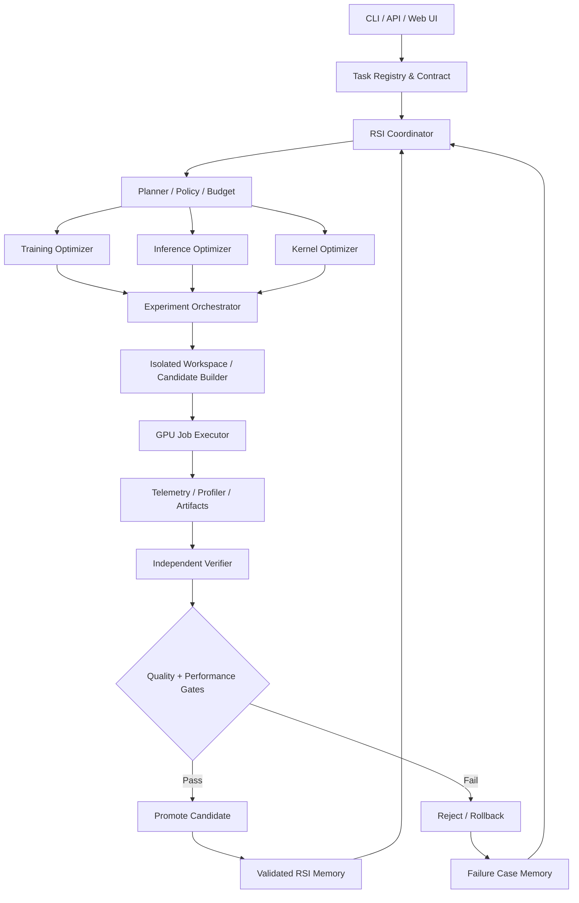
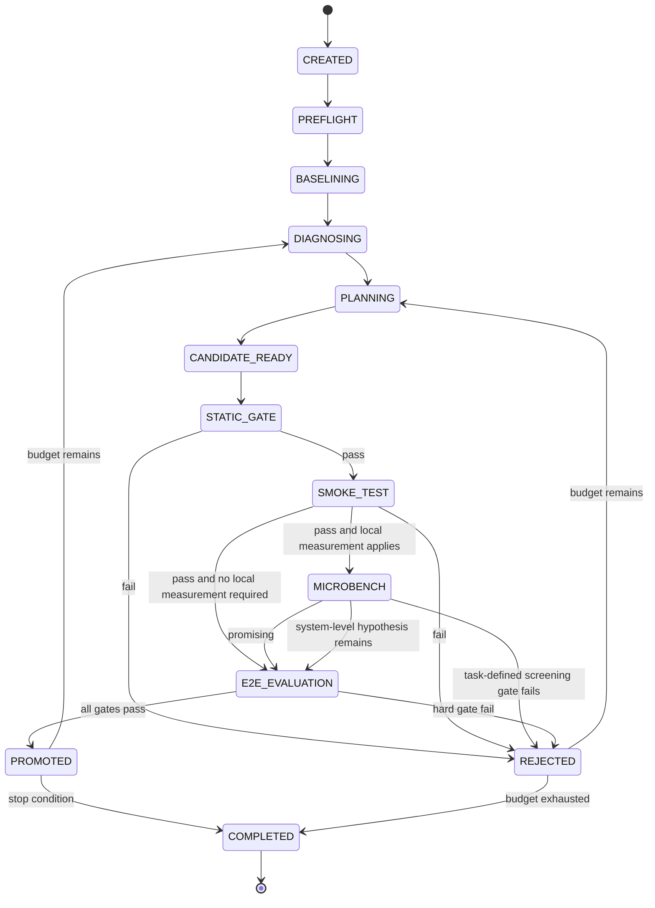

# AI Infra 优化 Runtime：调研与设计草案

> 版本：v1.1（设计草案）
> 调研基准日期：2026-11-25
> 目标：设计一个面向大模型训练、推理和 GPU Kernel 的自主性能优化平台（Autonomous AI Infrastructure Optimization Platform）。

本文讨论未来独立优化 Runtime 的候选架构，尚未实现，不替代本仓库的 [RSI 设计](RSI_DESIGN.md)。`jianzhnie/agent-rsi-infra` 已更名为 `jianzhnie/ai-infra-rsi`，两者是同一仓库；当前仍维护共享资源、客户端适配和验证工具。Runtime 是否立项，以真实任务、评估成本及维护需求为依据。

## 0. 设计概览

目标 Runtime 面向训练、推理和 GPU Kernel 优化，组织瓶颈分析、候选修改、实验执行、独立验证和结果归档。Agent 提出候选，执行系统运行任务，Verifier 判断是否达到固定验收条件；共享规则更新和发布仍由人工批准。

设计约束：

1. **Agent 不拥有最终验收权。** Agent 提出候选，独立 Verifier 决定通过或拒绝。
2. **任务契约先于优化。** 优化开始前锁定工作负载、模型/数据、训练语义、服务接口、质量标准、可修改范围与资源预算。
3. **端到端指标高于局部指标。** Kernel latency、GPU utilization 和 profiler trace 是诊断信号；最终晋级必须由固定协议下的训练/Serving E2E Benchmark 决定。
4. **所有实验必须可重建。** 保存代码差异、环境指纹、依赖、启动命令、编译产物、随机种子、GPU 分配和评估结果。生产级提交建议支持 OCI filesystem layer，而不是只保存 Git diff。
5. **先做垂直闭环，不先做大而全平台。** 第一阶段支持一个训练工作负载和一个推理工作负载；Kernel 优化作为被 Profiling 触发的子流程。
6. **RSI Memory 只收录通过验证的知识。** 失败经验可以保留，但不能与已验证 Recipe 混为一谈。

职责分为三个 Plane：

- **Control Plane**：Task Contract、Coordinator、Agent、策略搜索、预算与状态管理。
- **Execution Plane**：Agent Sandbox、GPU Job、Profiler、Artifact Builder。
- **Evaluation Plane**：独立 Correctness/Quality Gate、E2E Benchmark、Promotion/Rollback。

---

## 1. 目标与范围

### 1.1 目标能力

系统需要支持以下能力：

| 能力 | 系统行为 | 可验证产物 |
|---|---|---|
| 自主分析瓶颈 | 读取日志、Trace、GPU 指标和配置，判断瓶颈类别 | Bottleneck Report、Trace 引用、证据摘要 |
| 自主提出方案 | 基于瓶颈与历史经验提出可执行优化假设 | Hypothesis / Optimization Plan |
| 修改软件栈 | 修改训练参数、启动配置、服务配置、框架代码或 Kernel | Candidate Patch、Source Snapshot、OCI Layer |
| 自动执行实验 | 运行 Smoke、短时训练、推理回放、Profiler 和 Benchmark | Trial Logs、Metrics、Profile Artifacts |
| 独立判断 | 对执行、工作负载、数值/质量和性能进行验证 | Evaluation Report |
| 保留或回滚 | 仅将通过 Gate 的候选提升为 Best Candidate | Promotion Record / Rollback Record |
| 经验迁移 | 根据硬件、模型、框架、形状和工作负载检索历史经验 | Validated Recipe / Failure Case |
| 成本治理 | 限制 GPU-hour、Trial 数、Agent Token、墙钟时间 | Budget Ledger |

### 1.2 范围限制

初版范围不包含：

- 自动修改训练目标、数据集、Reward、Optimizer Semantics 来换取吞吐。
- 自动在生产集群直接发布未经审批的配置或 Kernel。
- 对所有 GPU 厂商、所有训练框架和所有推理引擎提供同等支持。
- 一开始就训练专用 RSI 模型或实现完整 RL 自我改进算法。
- 让 Agent 任意访问 SSH、集群凭证、对象存储密钥或 Benchmark 私有代码。
- 以单次 Benchmark、Agent 自报的性能数字或局部 Kernel 加速作为晋级依据。

初版围绕预先授权的优化任务执行，不承担通用集群运维。

---

## 2. 技术调研与项目经验提炼

### 2.1 代表项目

| 项目 | 主要优化范围 | 值得借鉴的设计 | 不宜直接照搬的部分 |
|---|---|---|---|
| [InfraRSI](https://github.com/TokenRhythm/InfraRSI) | 训练配置与代码联合优化 | Task Contract、冻结文件与不变量、多起点搜索、OOM/冲突归因、噪声标定、经验迁移、最终复测 | 当前定位主要是训练 Harness，不能直接代表完整 Inference/Kernel 平台 |
| [Amazon ATTUNE](https://github.com/amazon-science/attune) | LLM 训练吞吐优化 | One-lever-at-a-time、GPU-hour Budget、训练正确性/收敛 Gate、无人值守 Campaign | 对 Megatron-LM + slime + RayJobs 的适配较深，其他栈需要 Adapter |
| [AMD Hyperloom](https://github.com/AMD-AGI/Hyperloom) | AMD GPU 端到端推理 | Prelude、Enablement、Framework、Kernel、Sweep、Close 阶段；Coordinator/Critic/Specialist；Recipe KB；每次晋级重测 E2E | 当前 AMD GPU 和其生态组件适配较深入 |
| [AMD GEAK](https://github.com/AMD-AGI/GEAK) | 推理服务与 GPU Kernel | E2E Workflow 调用 Kernel Workflow；确定性编排；多 Agent 专业分工；知识库演进 | 不能把 AMD 专用工具链默认视为跨厂商通用 |
| [Alibaba Atrex Kernel Agent](https://github.com/alibaba/atrex-kernel-agent) | GPU Kernel 实现、分析、Profiling、优化 | Agent/Workspace/Execution/Evaluation/Knowledge Provider 插件化；Supervisor 独立审核；证据绑定源码快照 | 重点在 Kernel，不涵盖完整训练与 Serving 语义 |
| [OpenBMB ForgeTrain](https://github.com/OpenBMB/ForgeTrain) | Agent 自动构建训练框架 | 前后向对齐、分布式训练 Gate、长程训练质量门槛、逐算子优化 | 公开仓库的 Harness/Agent Loop 完整度需以其实际开源状态为准 |
| [OpenBMB ForgeKernel](https://github.com/OpenBMB/ForgeKernel) | Kernel 递归自演进 | 内外双循环、Milestone 决策图、Reference Promotion、硬件知识提炼 | 适合 Kernel 特化，不宜作为全平台主编排器 |
| [Meta KernelAgent](https://github.com/meta-pytorch/KernelAgent) | PyTorch 子图到 Triton Kernel | 静态分析、并行生成、数值验证、Profiler/NCU 反馈、Roofline 诊断、性能回退 | 更偏 KernelBench 与 Kernel 工作流 |
| [Karpathy AutoResearch](https://github.com/karpathy/autoresearch) | 单 GPU 小规模训练实验 | 最小化实验闭环、固定预算、单文件可审查、保留/撤销 | 单 GPU、简化训练任务，不是分布式 Infra 平台 |
| [UW VibeServe](https://github.com/uw-syfi/vibe-serve) | 专用 LLM Serving 系统生成 | 外层规划搜索系统设计，内层实现、正确性和性能验证；针对模型/硬件/工作负载特化 | 属于更激进的 Serving 系统合成方向，建议作为高级研究插件 |
| [RSIBench-Infra](https://rsibench-infra.github.io/) | 生产级训练与推理优化评测 | Task/Environment/Verifier 抽象、OCI Layer 提交、独立部署和 Benchmark Job、端到端质量门禁 | 公开主页仍标注 Code coming soon；其一次运行的排行榜结果是点估计，不能替代重复测量 |

### 2.2 设计依据

**结论 A：训练优化必须保护“训练的是同一个任务”。**

训练任务不能只检查进程是否成功退出。至少需要锁定数据、模型、有效 Batch、Token 数、Optimizer Steps、Optimizer/Objective、Loss 与 Gradient 行为。InfraRSI 展示了五层验证思路：执行、工作负载、调度、数值、计时/复测；ATTUNE 进一步强调更快的 Recipe 必须通过训练目标和收敛检查。

**结论 B：推理优化必须从真实 Serving Workload 出发。**

不能只用固定单请求测一个 Kernel。必须考虑请求长度分布、并发、到达模式、Prefix 复用、Prefill/Decode 比例、KV Cache、TTFT、TPOT/ITL 和最终输出质量。Hyperloom 的分阶段搜索和 RSIBench-Infra 的独立 Benchmark Job 是重要参考。

**结论 C：局部优化不等于端到端优化。**

Kernel 的单算子加速可能被 Launch、调度、数据传输、通信和其他算子抵消。Kernel Benchmark 适合筛选和诊断，最终必须回到原始训练/Serving 负载做 E2E 测量。

**结论 D：硬件和环境是实验输入，不是旁注。**

GPU 型号、拓扑、Driver、CUDA/ROCm、PyTorch、Compiler、Engine Commit、依赖版本、容器镜像和资源分配需要与实验结果绑定。只保存 Git Commit 无法重建包含 pip/apt、外部源码和编译产物的候选环境。

**结论 E：经验库的迁移要有兼容性判断。**

同一技巧在不同 GPU 架构、模型、Shape、框架版本和工作负载下的收益不同。InfraRSI 报告了跨 GPU SKU 的经验迁移收益；Hyperloom 则按模型、硬件、框架、模型架构、版本和精度等维度逐步放宽检索条件。应把“可迁移经验”与“完全兼容 Recipe”区分开。

### 2.3 RSIBench-Infra 评估协议

2026-11-18 发布的 RSIBench-Infra 把 Agent 优化对象从单层 Kernel 扩展到生产级完整训练/推理栈：20 个任务（16 inference、4 training），最高部署到 32 张 GPU/NPU；Agent 可以修改 Engine、Kernel 和软件栈；提交物使用 OCI filesystem layer；独立服务/训练 Job 与 Benchmark Job 分离。论文报告 130 个正式结果中，66.2% 超过 1.10x 验证加速。

其关键架构值得复用：

1. **Task = Instruction + Environment + Verifier**。
2. Agent 的工作环境与最终执行环境隔离。
3. 候选改动以 OCI filesystem layer 固化，避免只依赖 Git diff。
4. Benchmark Job 不运行在 Agent 修改过的文件系统中，而是通过对外服务接口评估候选。
5. 性能 Gate 与任务质量 Gate 分开。
6. 对训练使用冻结输入和数值轨迹，对推理使用固定请求/数据与任务特定质量评估。

注意：RSIBench-Infra 的公开主页目前仍标注代码即将开放；其榜单实验每个 model-task 主要是单次正式运行，并未报告重复运行置信区间。因此，可以借鉴它的任务和评估协议，但我们的生产晋级应增加重复测量与噪声控制。

---

## 3. 总体架构

### 3.1 三个 Plane



#### Control Plane

负责：

- Task Registry 与 Task Contract 校验。
- Coordinator、Agent 调用与上下文管理。
- 假设生成、策略选择、Trial 调度。
- GPU-hour、Token、美元成本、墙钟时间和最大 Trial 数预算。
- 状态持久化、暂停、恢复、取消和重试。
- Promotion Policy 与人工审批。

#### Execution Plane

负责：

- Git Worktree / Sandbox 管理。
- Agent 可修改文件范围控制。
- 容器/OCI 候选打包。
- Local、Slurm、Kubernetes/Ray 等执行后端。
- Training/Serving/Kernel Job 生命周期。
- Profiler、日志、Telemetry 和实验制品收集。

#### Evaluation Plane

负责：

- 运行独立的 Correctness、Numerical 和 Model Quality Gate。
- 运行预定义 E2E Benchmark。
- 评估资源约束、稳定性与可复现性。
- 将 Candidate 与 Baseline 做相同环境、相同负载和相同边界的对比。
- 由受信任端保存 Evaluation Report、内容摘要和审计记录，检测后续修改。
- 决定 Promotion、Reject、Needs Review。

**安全边界：Agent 不应能修改 Verifier、Benchmark 数据、评分代码或 Baseline Reference。**

### 3.2 Agent 角色设计

第一版建议只设置四个逻辑角色；它们可以使用同一个 LLM，也可以使用不同模型。

| 角色 | 职责 | 可执行动作 | 不允许的权限 |
|---|---|---|---|
| Coordinator / Planner | 读取任务和状态，决定下一步，维护预算和搜索方向 | 创建 Hypothesis、调度工具、停止 Campaign | 直接覆盖 Verifier 结果 |
| Diagnoser | 分析 Trace、日志、配置和性能计数器，形成瓶颈假设 | 读取 Profiling、查询知识库、提出证据引用 | 直接将性能猜测当作实测结果 |
| Specialist Optimizer | 对训练、推理或 Kernel 进行具体实现修改 | 在 Sandbox 内修改白名单文件、运行允许的 Smoke/Local Test | 访问生产凭证、修改 Benchmark、直接晋级 |
| Critic / Auditor | 检查变更是否符合任务目标、是否引入作弊或语义变化 | 审阅 Diff、检查假设和证据、触发人工复核 | 代替程序化 Verifier 决定性能是否通过 |

独立 Verifier 是程序系统，不是另一个“自称客观”的 LLM。可以增加第二模型做代码审计，但硬性 Gate 应来自代码和固定测试。

### 3.3 Agent 调用粒度

不建议为每个小步骤创建独立 Agent。Agent 调用会带来 Token 成本、上下文切换、状态同步和互相矛盾的计划。

推荐：

- Planner：每轮 1 次或在状态变化时执行。
- Diagnoser：仅在有新 Trace/失败/指标异常时触发。
- Specialist：按工作负载类型动态选择。
- Critic：只在候选提交或准备晋级时运行。
- Verifier：每个需要验证的候选都必须运行，但不依赖 LLM 判断。

---

## 4. 统一 Task Contract

统一契约承载训练、推理和 Kernel 任务共有的身份、约束、预算与证据；具体计算语义由各任务的 Verifier 定义。

### 4.1 Task 的核心组成

建议抽象为：

`Task = Instruction + Environment + Objective + Constraints + SearchSpace + Verifier + Budget + Permissions`

其中：

- `Instruction`：任务说明和优化目标。
- `Environment`：可运行的 Baseline、模型/数据资产、硬件资源和依赖。
- `Objective`：主指标及优化方向。
- `Constraints`：训练/推理语义、模型质量、内存、延迟 SLO 等硬约束。
- `SearchSpace`：可调参数和可修改代码边界。
- `Verifier`：独立验证脚本、质量门槛和测量协议。
- `Budget`：GPU-hour、Trial 数、Token、美元、时间。
- `Permissions`：文件、网络、GPU、容器、远程资源等执行权限。

### 4.2 Task YAML 示例

```yaml
apiVersion: rsinfra.ai/v1alpha1
kind: OptimizationTask
metadata:
  name: qwen-training-throughput
  owner: infra-team
  labels:
    domain: training
    priority: experiment

spec:
  workload:
    type: training
    framework: megatron
    entrypoint: ./train.sh
    model: Qwen-8B
    workload_profile: sequence-8k-bf16

  environment:
    base_image: registry.example/torch-megatron@sha256:<64-hex-digest>
    git_revision: 4c5e...
    accelerator:
      vendor: nvidia
      model: H100
      count: 8
      topology: single-node
    framework_versions:
      torch: "2.x"
      cuda: "12.x"

  objective:
    primary_metric: tokens_per_second_per_gpu
    direction: maximize
    secondary_metrics:
      - mfu
      - peak_memory_gb

  constraints:
    immutable:
      - model_weights
      - dataset_digest
      - tokenizer_digest
      - optimizer_semantics
      - global_batch_size
      - sequence_length
      - optimizer_steps
    numerical:
      loss_relative_tolerance: 0.03
      grad_norm_tolerance: 0.05
    resources:
      max_gpu_memory_gb: 78

  search_space:
    tunable_parameters:
      - activation_checkpointing
      - communication_overlap
      - cuda_graph_mode
      - micro_batch_size
    editable_paths:
      - train/**/*.py
      - configs/**/*.yaml
    frozen_paths:
      - data/**
      - evaluation/**
      - loss/**

  verifier:
    smoke_test: tests/smoke_train.sh
    correctness: tests/verify_training.py
    benchmark: benchmarks/train_throughput.py
    repetitions: 3

  budget:
    max_trials: 24
    max_gpu_hours: 8
    max_agent_tokens: 500000
    max_wall_time: 8h
    max_parallel_trials: 1

  permissions:
    network: false
    git_push: false
    filesystem_write_scope: workspace
    privileged_container: false
```

以下字段仅用于说明契约，尚无可执行 Schema。实现时需补齐精确版本、资产摘要和字段校验，并明确与现有任务报告 JSON v1 的转换关系。

### 4.3 不同任务共用 Contract，但使用不同 Verifier

| Workload | 任务不变量 | 主性能目标 | 质量验证 |
|---|---|---|---|
| Pretraining / SFT | 模型、数据、Tokenizer、Objective、有效 Batch、Optimizer Steps | Tokens/s/GPU、Steps/hour、MFU | Loss 曲线、Grad Norm、Checkpoint/参数检查、任务评测 |
| RL / GRPO / PPO | Reward、Rollout 数、采样策略、Update 数、KL/Policy 目标 | Complete Workload Steps/hour | Reward/Advantage 构造、Policy/KL Loss、Forward 输出与 Gradient 检查 |
| LLM Serving | 模型权重、Tokenizer、Sampling、Context、请求到达和输出预算 | Tokens/s、Requests/s、Cost/token | 固定请求集质量、输出一致性、任务准确率 |
| Multimodal Serving | 模型、Processor、输入媒体、分辨率、生成设置 | Frames/s、Videos/hour、Audio seconds/s | 参考媒体/动作/语音质量 |
| GPU Kernel | Shape、Stride、Dtype、Layout、边界和调用语义 | Latency、Bandwidth、有效吞吐 | Reference 对比、误差容忍、Sanitizer、Shape 覆盖 |

---

## 5. 优化闭环与状态机

### 5.1 状态机草案



微基准是按需诊断或筛选项。调度、通信重叠、内存生命周期等系统改动可直接进入短时 E2E；局部耗时变化不能单独否定尚待验证的整体收益。是否设置微基准淘汰门槛在任务契约中预先约定。

每个状态都必须持久化，允许进程退出后从已完成的 Trial 恢复。不要让“状态”只存在于对话上下文中。

### 5.2 标准 Campaign 流程

**Phase 0：Initialize / Contract Validation**

- 解析任务配置。
- 校验模型、数据、基线、资源、编辑范围和预算。
- 记录冻结文件、依赖和仓库 Commit。
- 生成 `task_manifest.json`。

**Phase 1：Preflight / Doctor**

- 检查 GPU、Driver、CUDA/ROCm、通信拓扑和依赖。
- 运行原始任务，确认基线可执行。
- 检查日志和指标信号是否完整。
- 标定测量噪声和资源占用。
- 建立 Environment Fingerprint。

**Phase 2：Baseline & Profiling**

- 完成多次 Baseline 测量。
- 收集端到端指标和分阶段耗时。
- 按瓶颈分类：Compute-bound、Memory-bound、Communication-bound、Launch-bound、CPU-bound、Input-bound、KV-cache-bound 等。
- 生成带证据引用的 Bottleneck Report。

**Phase 3：Hypothesis & Planning**

- 从当前瓶颈、Search Space 和 Memory 检索优化方案。
- 生成有限数量的候选假设。
- 为每个假设定义预期改动、适用条件、风险、依赖、验证方法和预算。
- 优先尝试高收益、低风险、低成本的改动。

**Phase 4：Candidate Implementation**

- 建立独立 Git Worktree 或容器工作区。
- Specialist 修改候选。
- 生成 Patch、Source Snapshot 和候选摘要。
- 检查修改是否超出允许文件范围。

**Phase 5：Multi-fidelity Evaluation**

从便宜到昂贵逐层执行：

1. 静态检查、配置 Schema、安全策略。
2. Smoke Test、编译、短时执行。
3. 按需执行单算子或局部 Microbenchmark；无适用测量项时记录不适用依据。
4. 短时训练/推理 E2E。
5. 完整任务质量 Gate。
6. 独立重复 Benchmark。

低层失败应尽早停止，不应把 GPU 小时浪费在明显错误的候选上。

**Phase 6：Promotion / Rollback**

- 所有硬性 Gate 必须通过。
- 性能收益必须超过噪声阈值。
- 在规定复测中能够复现。
- 生成 Promotion Record。
- 否则拒绝候选并保留失败证据。

**Phase 7：Knowledge Distillation**

- 通过的候选形成 Validated Recipe。
- 失败候选形成 Failure Case。
- 将“成功条件、硬件条件、工作负载条件、冲突条件、证据”写入记忆库。
- 不自动将所有 Agent 输出提升为长期知识。

---

## 6. 专业优化 Agent 设计

### 6.1 Training Optimizer

训练优化的推荐搜索顺序：

1. **启动配置和运行参数**：Micro-batch、Sequence Packing、Activation Checkpointing、并行度和通信开关。
2. **框架级优化**：DDP/FSDP/Megatron 并行策略、Overlap、Bucket、Pipeline、Expert Parallel 等。
3. **编译与执行策略**：torch.compile、CUDA Graph、算子融合、内存布局。
4. **算子与 Kernel**：RMSNorm、RoPE、Attention、GEMM、Loss、Optimizer 等。
5. **更深层系统改造**：通信调度、运行时和专用 Kernel/Compiler。

建议覆盖的关键瓶颈：

- Forward / Backward / Optimizer 各阶段时间。
- GPU SM 利用率、Tensor Core 活跃程度和 Memory Bandwidth。
- NCCL/Collective 等待与通信重叠情况。
- DataLoader、CPU Tokenization、存储和数据搬运。
- Activation/Optimizer/Gradient 内存占用。
- MoE Token Routing、Expert Load Balance。

**硬性约束：** 不能通过减少 Token 数、减少 Optimizer Steps、缩小有效 Batch、改变 Loss/Reward、漏掉通信或将工作移出计时窗口来制造加速。

### 6.2 Inference Optimizer

建议按以下层次搜索：

1. **Serving Flags**：Max Num Seqs、Max Batched Tokens、Scheduler、Prefill Chunking、KV Cache 配置。
2. **执行路径**：Attention Backend、Graph Capture、Prefix Cache、Chunked Prefill。
3. **内存策略**：KV Cache Block、Paged Attention、Host Cache、Offload、Cache Reuse。
4. **并行策略**：TP、PP、DP、EP、Expert Placement 和通信。
5. **解码策略**：Speculative Decoding、MTP、Batch Scheduler、Continuous Batching。
6. **Kernel 优化**：Attention、GEMM/GEMV、MoE、Quantization Kernel。
7. **自定义 Serving Runtime**：仅作为高级模式，不能默认重写成熟引擎。

关键诊断：

- Prefill-bound 还是 Decode-bound。
- GPU Compute-bound 还是 Memory-bandwidth-bound。
- KV Cache 容量还是访问带宽成为瓶颈。
- CPU Scheduler、Tokenizer、Network 或 RPC 是否成为瓶颈。
- TP/EP 通信是否影响 TPOT 和吞吐。
- Prefix Cache 命中、请求长度和并发是否符合目标生产分布。

### 6.3 Kernel Optimizer

Kernel Optimizer 不应该独立地无限生成 Kernel。它应由 Training/Inference Agent 根据 Profiling 结果触发。

执行过程：

1. 从 E2E Trace 找到热点算子。
2. 抽取真实 Shape、Stride、Dtype、Layout 和调用参数。
3. 建立独立 Reference Microbenchmark。
4. 生成 CUDA/Triton/CuTeDSL/HIP 等候选实现。
5. 执行数值正确性、边界 Shape 和 Sanitizer 测试。
6. 使用 Nsight Compute / ROCm Profiler 做指标诊断。
7. 比较候选的 Kernel 时间和 Launch/Wrapper 时间。
8. 集成回原始框架，重新执行 E2E Benchmark。
9. 只有 E2E 指标提升且 Quality Gate 通过，才将 Kernel 作为有效优化晋级。

单 Kernel 加速比不直接换算为服务吞吐收益。

---

## 7. Profiling 与瓶颈诊断体系

### 7.1 分层观测

| 层级 | 采集内容 | 主要工具候选 |
|---|---|---|
| Job 层 | Job 时间、失败原因、退出码、CPU/GPU 分配 | Executor、Slurm/K8s 事件 |
| GPU 节点层 | SM/Memory 利用率、显存、功耗、温度、时钟、PCIe/NVLink | NVIDIA DCGM、厂商遥测 |
| Framework 层 | Operator 时间、CPU/GPU Trace、Tensor Shape | PyTorch Profiler/Kineto |
| Kernel 层 | Occupancy、Bandwidth、Cache、Stall、Warp、Launch | Nsight Systems/Compute、rocprof |
| Training 层 | Step Time、Forward/Backward/Optimizer、NCCL、MFU | Framework Hooks、Profiler |
| Serving 层 | Queue、TTFT、TPOT/ITL、Request Rate、KV Cache | vLLM/SGLang Benchmark/metrics |
| Network/Storage 层 | NCCL、RDMA、文件读取、数据等待 | NCCL traces、系统监控 |

工具必须通过 Profiler Adapter 封装；Agent 不应该直接生成任意系统级采集命令并默认获得节点权限。

### 7.2 Bottleneck Report Schema

```json
{
  "task_id": "qwen-serving-001",
  "baseline_id": "base-001",
  "bottlenecks": [
    {
      "category": "memory_bandwidth_bound",
      "component": "attention_decode",
      "evidence": [
        "trace://trial-001/nsys.sqlite#range=decode_attention",
        "metric://trial-001/dcgm/mem_bw"
      ],
      "impact_estimate": "high",
      "confidence": 0.82,
      "candidate_actions": [
        "evaluate_attention_backend",
        "reduce_kv_cache_memory_traffic"
      ]
    }
  ]
}
```

注意：`confidence` 表示诊断证据的可信度，不表示 Agent 预测的性能加速一定成立。预计加速只能作为搜索排序的弱先验，不能作为最终评分。

### 7.3 Profiling 的成本策略

- 先用低开销 Telemetry 找方向。
- 再对少量代表性 Trial 运行重型 Profiler。
- 不要每个 Trial 都开启 Nsight Compute 全指标采集。
- Profiling 结果与 Benchmark 结果分开保存。
- 记录 Profiling 开销，避免把 Profiling 期间性能数字当成正式性能结果。

---

## 8. 搜索策略

推荐使用 Hybrid Search：LLM 负责提出代码级假设和解释，传统优化器负责结构化参数搜索，Evaluator 只认真实测量。

### 8.1 搜索空间分层

| 搜索类型 | 适合的方案 | 示例 |
|---|---|---|
| 离散配置 | TPE / Bayesian / 分层枚举 | Attention Backend、Graph Mode、Parallelism |
| 连续参数 | Bayesian Optimization / TPE | Batch Token Budget、Cache Fraction |
| 组合约束 | Rule-based + Constraint Solver | 显存约束、参数冲突、并行策略组合 |
| 源码改动 | LLM Hypothesis + Patch + Verification | Kernel Fusion、Communication Overlap |
| Kernel Schedule | Specialized Agent + Cost Model + Profiler | Tile、Warp、Pipeline、Memory Layout |

### 8.2 推荐搜索策略

1. **多起点**：Baseline、Validated Recipe、Agent 推荐和少量合法随机配置。
2. **低成本探测**：先判断参数是否可运行、是否冲突、是否超显存。
3. **单变量归因**：优先一次改一类变量；只有已知需要组合的参数才作为 Bundle 搜索。
4. **多保真评估**：短试验淘汰差候选，长试验验证优胜者。
5. **自适应预算**：把更多 GPU-hour 分给高潜力且尚未充分验证的候选。
6. **平台期处理**：从当前 Best 之外的分支重新启动，扩大搜索范围或改变优化层级。
7. **停止条件**：预算耗尽、达到目标、连续多轮无超噪声收益、风险超限或用户停止。

### 8.3 Hypothesis Contract

```yaml
hypothesis_id: H-0042
bottleneck: communication_bound
claim: overlap gradient communication with backward compute
change_scope:
  - distributed/communication.py
  - configs/distributed.yaml
expected_effect:
  metric: step_time_ms
  direction: minimize
risk: medium
preconditions:
  - nccl_backend: enabled
  - topology: nvlink
conflicts:
  - incompatible_bucket_mode
validation_plan:
  - smoke_distributed
  - loss_curve_compare
  - end_to_end_step_benchmark
budget:
  gpu_hours: 0.5
```

每个 Hypothesis 都要能被实验否证。没有明确证据、改动范围和验证计划的“优化建议”不应该进入执行阶段。

---

## 9. Benchmark 与独立评估体系

评估端负责核对候选是否满足任务约定，并保留原始测量证据。

### 9.1 Gate 分类

| Gate | 检查内容 | 失败后处理 |
|---|---|---|
| G0 Policy / Security | Diff 白名单、权限、依赖、禁止改动 | 直接拒绝或人工复核 |
| G1 Execution | 编译、启动、Smoke、退出码、OOM、NCCL 错误 | 标记失败原因，保留日志 |
| G2 Correctness / Quality | 工作负载不变量、数值误差、模型质量、输出一致性 | 不允许晋级 |
| G3 Performance | 相同协议下 E2E 指标、噪声和复测 | 不满足收益门槛则不晋级 |

推荐增加 G4 Stability：长时间稳定性、Checkpoint/Resume、资源泄漏、异常恢复。对于 MVP，G4 可作为完整晋级的第二阶段要求。

### 9.2 Training 评估

必须冻结：

- 模型初始权重和架构。
- 数据集/样本顺序/Tokenizer。
- Effective Batch、Sequence Length、Packing 规则。
- Optimizer 类型与语义、Learning Rate Schedule、Loss/Reward。
- 训练步数与计时边界。
- Precision 允许范围。

报告指标：

- Tokens/s/GPU、Steps/hour、Step Time。
- MFU、GPU Utilization、Peak Memory。
- Forward/Backward/Optimizer/Communication/Data Loader 时间。
- Loss 曲线、Grad Norm 曲线、必要的参数差异。
- 需要时增加最终模型质量评测。

对于 RL/GRPO/PPO，不能只看训练 Step Time；Rollout、Weight Sync、Reference/Old-policy Forward、Reward/Teacher Scoring 和 Optimizer Updates 等必要工作都要纳入完整 Workload Step。

### 9.3 Inference 评估

必须冻结：

- 模型权重、Tokenizer/Processor、Sampling 参数。
- Request Trace、Prompt/Output 长度分布、Context Limit。
- 到达模式、并发度、Prefix Reuse 和请求顺序。
- 测量窗口、Warmup 规则和服务端/客户端计时边界。

报告指标：

- Output Tokens/s、Request/s、Cost per Million Tokens。
- TTFT P50/P95/P99。
- TPOT/ITL P50/P95/P99。
- Queue Time、Prefill Throughput、Decode Throughput。
- KV Cache Utilization、Preemption/Retry、OOM。
- 任务质量：如 LongBench、GSM8K、MMMU 或媒体/语音专用校验，按任务选择。

请求统计须使用固定请求 ID 和 offered load（请求总数、到达时间及输入），记录提交、接收、完成、拒绝、超时、取消、错误和不完整输出；区分原始请求与重试 attempt，避免重复计数。请求类别的关系、截止时间和窗口结束后的 drain 规则在测量前确定。

延迟分位数注明统计样本及分母，同时报告完成率、错误率和 SLO 达标率。失败与超时不得从整体验收中消失；主动取消只在契约预先定义时按相同规则处理。任务设定最低完成率、最高错误率和延迟 SLO，防止通过丢弃慢请求制造吞吐收益。

goodput 定义为同一测量协议下，同时满足输出质量、完整性及延迟 SLO 的成功请求数/计时长度；使用 token goodput 时明确有效 token 的计数方式。不完整输出或失败请求不能计入有效吞吐。闭环并发测试的实际请求率可能变化，应单独报告，不能把相同并发等同于相同 offered load。

vLLM 的 `vllm bench serve` 已提供客户端测得的 TTFT、ITL、TPOT 等测量定义；不同工具对指标名称的定义并不总一致，因此必须同时保存计算公式和测量点，而不是只比较字段名。

### 9.4 Kernel 评估

- Reference Implementation 和候选 Kernel 使用同样输入。
- 验证 Shape、Stride、Dtype、Layout、边界尺寸和数值误差。
- 防止 PyTorch fallback 或 CPU fallback 被误认为 Kernel 优化。
- 记录 Kernel 时间、Launch/Wrapper 时间和 E2E 调用成本。
- 必要时运行 Compute Sanitizer / 内存检测。
- 最终仍要做 E2E Integration Test。

### 9.5 噪声标定和统计策略

不要使用固定的“提速 2% 就晋级”规则。不同集群的测量噪声可能差异很大。

执行要求：

1. Baseline 先运行多次，确认稳定性。
2. 测量空闲资源、GPU Clock、温度、功率和背景进程。
3. 使用相同节点/设备做成对比较。
4. 对候选与 Baseline 采用 ABBA 或随机交错顺序，降低时间漂移影响。
5. 计算 Median、MAD/分位数和置信区间。
6. 当置信区间跨过零收益阈值时，增加重复次数或标记 Inconclusive。
7. 对最终 Winner 进行新 Job 的独立复测。

晋级条件：

```text
Promote(candidate) =
    policy_gate_pass
    AND execution_gate_pass
    AND quality_gate_pass
    AND performance_gain_above_noise
    AND independent_rerun_pass
    AND required_stability_gates_pass
    AND budget_and_resource_constraints_pass
```

所有硬 Gate 是 AND 关系。质量不通过时，不应允许更高吞吐抵消质量损失。

### 9.6 性能与质量分开报告

不要把 Accuracy、Loss、Latency、Throughput 简单加权成一个 Reward 后只报一个分数。

执行要求：

- 质量和任务语义：硬性约束或 Non-inferiority Gate。
- 性能：主目标指标。
- 显存、GPU-hour、能耗、成本：次级目标或约束。
- 多目标结果：报告 Pareto Frontier，而不是只留下一个模糊的总分。

---

## 10. Candidate Artifact 与可复现执行

### 10.1 为什么 Git Diff 不够

AI Infra 优化可能同时修改：

- Git Repository 中的源码。
- pip/apt 安装的依赖。
- 外部 Submodule 或第三方源码。
- 编译后的 `.so` / PTX / Triton Cache。
- 环境变量与启动脚本。
- 容器内部其他安装目录。

因此 Candidate Artifact 至少要支持：

```text
CandidateArtifact
├── baseline_image_digest
├── source_revision
├── patch_digest
├── filesystem_layer_digest
├── dependency_lock_digest
├── build_recipe
├── launch_entrypoint
├── environment_manifest
└── artifact_manifest.json
```

开发阶段可以先使用 Git Worktree + Patch + Lockfile；当需要多节点、外部源码和编译产物时，应升级为 OCI filesystem layer 或基于 OCI Image 的不可变候选版本。

### 10.2 三环境隔离模型

```text
Agent Job
  - Agent 读取任务与源码
  - 修改自己的 Workspace
  - 不拥有 Verifier 或评分脚本
  - 输出 Candidate Artifact

Serve / Train Job
  - 从干净的 Baseline Image 启动
  - 应用指定 Candidate Artifact
  - 所有分布式 Rank 使用同一 Artifact Digest
  - 对外提供待测服务，或执行训练任务

Benchmark Job
  - 独立于 Agent Job
  - 不加载 Agent 的 Workspace
  - 使用受信任的请求发生器/训练驱动/数据
  - 通过服务接口或受控执行接口评估候选
  - 质量和性能评分逻辑对 Agent 不可写
```

对于训练，Benchmark 驱动可以通过一个受信任控制端启动 Candidate Train Job，但任务数据、评测逻辑、计时边界和结果检查必须由受信任端控制。

### 10.3 环境指纹

每个 Baseline 和 Candidate 都必须记录：

- Git Commit / Dirty Diff。
- OCI Image Digest。
- GPU 型号、数量、架构、拓扑。
- Driver、CUDA/ROCm、Compiler、Python、PyTorch。
- 推理/训练框架版本与启动参数。
- NCCL/RCCL、通信库和网络配置。
- CPU、内存、NIC、Storage。
- 依赖锁定文件和模型/Tokenizer/数据摘要。
- Seed、Workload Profile、测量协议版本。

如果 Baseline 和 Candidate 的环境指纹存在不允许的差异，则该组结果不能直接比较。

---

## 11. RSI Memory：从“存档”升级为“可验证经验系统”

### 11.1 四层 Memory

| Memory 类型 | 内容 | 示例 |
|---|---|---|
| Episode Memory | 每次 Campaign/Trial 的完整记录 | 某候选 OOM、某次 Profiling 结果 |
| Case Memory | 可检索的完整成功/失败案例 | H100 + Megatron + 8B + Seq8K 的最佳 Recipe |
| Procedural Memory | 经验证的策略与工作流 | 如何定位 NCCL 通信瓶颈 |
| Hardware/Cost Model | 硬件机制和实测性能模型 | 不同 GPU 上 GEMM/Attention 的成本规律 |

### 11.2 Experience Record

```yaml
experience_id: exp-000184
status: validated
workload:
  type: inference
  model_family: decoder_moe
  engine: sglang
hardware:
  vendor: nvidia
  architecture: hopper
  gpu_count: 8
software:
  driver: "..."
  cuda: "..."
  engine_revision: "..."
optimization:
  category: kv_cache
  change_summary: increase_gpu_cache_and_enable_host_tier
observed_effect:
  throughput_ratio: 1.18
  ttft_p95_ratio: 0.97
  tpot_p95_ratio: 0.94
constraints:
  quality_gate: pass
  max_memory_gb: 78
  workload_signature: sha256:...
evidence:
  artifact_digest: sha256:...
  evaluation_report: report://...
compatibility:
  model_family: compatible
  gpu_architecture: needs_probe
  engine_version: tested_range
```

### 11.3 Memory Promotion Rules

- `validated`：独立评估通过，环境和证据完整。
- `experimental`：Agent 提出但尚未充分验证。
- `failed`：失败案例，记录失败原因和环境上下文。
- `deprecated`：在新版本硬件/框架上已不适用。

只有 `validated` 可作为自动搜索的强先验。失败案例应作为“警告和上下文”，不能在条件变化后被无条件禁止重试。

### 11.4 跨任务经验迁移

检索优先级：

1. 相同模型、硬件、框架、Workload Signature。
2. 相同 GPU 架构、不同型号。
3. 相同模型类型和执行框架。
4. 相同 Operator/Kernel Shape 与 Dtype。
5. 更广泛的硬件机制知识。

检索时返回 Compatibility Score 和适用条件；跨硬件 Recipe 只能作为 Warm Start，必须重新测量，不能直接复用性能结论。

建议第一版先用结构化 Metadata + SQL 筛选 + 文本检索，不要一开始就把所有经验都塞进 Vector DB。后续当知识量足够大，再增加 Embedding/向量检索。

---

## 12. 安全、权限和资源治理

### 12.1 权限分级

| Level | 权限 | 默认策略 |
|---|---|---|
| P0 | 读取代码、文档、日志、Profiling | 允许 |
| P1 | Workspace 内源码修改、静态检查、低风险 Smoke | 任务授权 |
| P2 | GPU Job、依赖安装、容器构建、Profiling | 明确授权和资源配额 |
| P3 | SSH/远程集群管理、生产发布、Git Push、资源扩容 | 人工审批 |

### 12.2 执行隔离

- Agent Workspace 与 Verifier Workspace 分离。
- 文件系统采用最小可写范围。
- 网络默认关闭或域名 Allowlist。
- GPU Job 设定 GPU 数、CPU、内存、时长和显存限制。
- 容器默认非特权运行，禁止默认挂载宿主机敏感目录。
- 凭证通过 Secret Manager 注入，Agent Prompt 不包含凭证。
- 高风险命令使用 Policy Engine 拦截和审批。
- Candidate Artifact 记录来源、Hash、依赖和完整变更清单。
- 生产部署和 Git Push 不由 Agent 自动执行。
- Agent 不可读取独立评测的私有输入或隐藏评分逻辑。

### 12.3 资源与预算

同时限制：

- `max_trials`
- `max_gpu_hours`
- `max_wall_time`
- `max_agent_tokens`
- `max_llm_cost_usd`
- `max_parallel_trials`
- `max_compile_time`

所有失败 Trial 的成本都要记入账本，不能只统计成功候选。

---

## 13. Runtime 技术选型候选

第一版不需要微服务化。建议先做模块化 Python Monolith + 独立 GPU Worker，等需要多租户和大规模 Campaign 后再拆分服务。

| 层 | MVP 建议 | 后续扩展 |
|---|---|---|
| Language | Python 3.11+ | Python + 少量 Go Worker |
| CLI / API | Typer + Pydantic v2；必要时 FastAPI | 多租户 REST/gRPC |
| Agent Adapter | Provider-neutral LLM Adapter；CLI Agent Adapter | Claude/Codex/OpenAI-compatible/local LLM |
| Agent Orchestration | 受控 Python State Machine | Temporal 或 Durable Workflow Engine |
| Search | Optuna/TPE + 自定义约束搜索 + LLM Patch Search | 多目标 Bayesian/多保真/调度优化 |
| Workspace | Git Worktree + 临时目录 | OCI Layer / Remote Workspace |
| Local Execution | subprocess + Docker | BuildKit、容器服务 |
| Cluster Execution | 先选用户实际已有的 Slurm 或 Kubernetes | Slurm + Kubernetes/Ray 多后端 |
| GPU Observability | PyTorch Profiler、DCGM、Nsight | ROCm Profiler、厂商 Adapter |
| Serving Benchmark | vLLM/SGLang 原生 Benchmark Adapter | GenAI-Perf、固定 Trace Replay |
| Metadata Store | SQLite（单机 MVP） | PostgreSQL |
| Artifact Store | 本地目录 | S3/MinIO/OCI Registry |
| Metrics | JSONL + CSV | Prometheus + OpenTelemetry |
| Memory | SQLite/Postgres 结构化经验库 | pgvector/全文检索/性能模型 |
| Tests | pytest、静态校验、契约测试 | 多 GPU 回归集群 |

设计原则：

- 不要为了 Agent 而强制采用一个庞大的 Agent Framework。
- Agent 状态由平台持久化，不依赖聊天历史。
- 不要让 Orchestrator 和 GPU Runtime 共享一个可被 Agent 修改的进程空间。
- Ray 不是必须项：单节点可先使用 Docker/Local Executor；多节点根据现有集群选择 Slurm 或 Kubernetes/Ray。
- 首先支持一种主力 GPU 软件栈，再通过 Adapter 扩展 NVIDIA/AMD/其他硬件。

---

## 14. 未来 Runtime 目录草案

```text
ai-infra-rsi/
├── pyproject.toml
├── README.md
├── configs/
│   ├── profiles/
│   ├── hardware/
│   └── policies/
├── schemas/
│   ├── task.schema.json
│   ├── candidate.schema.json
│   └── evaluation.schema.json
├── src/aiinfra_rsi/
│   ├── cli/
│   ├── api/
│   ├── core/
│   │   ├── contracts.py
│   │   ├── state_machine.py
│   │   ├── events.py
│   │   └── errors.py
│   ├── coordinator/
│   ├── agents/
│   │   ├── planner.py
│   │   ├── diagnoser.py
│   │   ├── critic.py
│   │   └── specialists/
│   │       ├── training.py
│   │       ├── inference.py
│   │       └── kernel.py
│   ├── search/
│   │   ├── strategies.py
│   │   ├── constraints.py
│   │   ├── scheduler.py
│   │   └── budget.py
│   ├── workloads/
│   │   ├── base.py
│   │   ├── training/
│   │   ├── inference/
│   │   └── kernel/
│   ├── executors/
│   │   ├── local.py
│   │   ├── docker.py
│   │   ├── slurm.py
│   │   └── kubernetes.py
│   ├── profilers/
│   │   ├── torch_profiler.py
│   │   ├── nvidia.py
│   │   └── rocm.py
│   ├── evaluators/
│   │   ├── policy.py
│   │   ├── correctness.py
│   │   ├── training.py
│   │   ├── inference.py
│   │   ├── kernel.py
│   │   └── statistics.py
│   ├── artifacts/
│   ├── memory/
│   ├── policies/
│   └── reporting/
├── skills/
│   ├── training/
│   ├── inference/
│   └── kernel/
├── tasks/
│   ├── examples/
│   └── benchmark_suites/
├── tests/
│   ├── unit/
│   ├── contract/
│   ├── integration/
│   └── gpu/
└── tools/
```

### 14.1 与当前资源仓库的关系

当前仓库为 [jianzhnie/ai-infra-rsi](https://github.com/jianzhnie/ai-infra-rsi)，旧名为 `agent-rsi-infra`。本节不再将新旧名称视为两个项目。

- 当前资源仓库维护指令、Skills、角色、工程规范、客户端适配、报告校验和来源记录，职责以 `RSI_DESIGN.md` 为准。
- 本文的目录树、Executor、Campaign、Evaluator 和 Memory Runtime 是未来实现草案。若独立立项，另行确定仓库名称、接口和维护责任；不因仓库改名就启动迁移或改变现有目录。
- 外部 Runtime 按固定 commit 或资源清单摘要加载本仓库内容，并绑定任务与验证协议版本。现有脚本只做结构和状态校验，不承担 GPU 调度或最终验收。


---

## 15. 接口草案

### 15.1 Workload Adapter

```python
from typing import Protocol

class WorkloadAdapter(Protocol):
    def validate_task(self, task: "TaskSpec") -> None: ...
    def prepare_baseline(self, task: "TaskSpec") -> "BaselineManifest": ...
    def launch(self, candidate: "CandidateArtifact", task: "TaskSpec") -> "JobHandle": ...
    def collect_metrics(self, job: "JobHandle") -> "MetricBundle": ...
    def stop(self, job: "JobHandle") -> None: ...
```

Training、Inference 和 Kernel Adapter 应分别实现任务特定语义，但复用通用 Job/Artifact/Metric Contract。

### 15.2 Evaluator

```python
class Evaluator(Protocol):
    def validate_artifact(self, candidate: "CandidateArtifact") -> "GateResult": ...
    def run_correctness(self, candidate: "CandidateArtifact", task: "TaskSpec") -> "GateResult": ...
    def run_quality(self, candidate: "CandidateArtifact", task: "TaskSpec") -> "GateResult": ...
    def run_benchmark(self, candidate: "CandidateArtifact", task: "TaskSpec") -> "BenchmarkResult": ...
    def decide(
        self,
        task: "TaskSpec",
        report: "EvaluationReport",
    ) -> "PromotionDecision": ...
```

`EvaluationReport` 由受信任评估端汇总，至少绑定 task/contract digest、candidate artifact digest、baseline digest、测量协议版本、执行 attempt、原始证据，以及 policy、execution、correctness/quality、performance、独立复测、资源约束和任务要求的 stability 结果。未测、失败、阻塞和不适用分别保存，不用空值表示通过。

`decide()` 核对身份、必需 Gate 清单及证据是否完整。必需项失败则拒绝，缺失、阻塞、未执行或 inconclusive 则不得晋级；不适用须符合任务契约预先定义的条件。性能结果只能参与性能判断，不能覆盖质量等其他 Gate。候选成为实验 best 与共享规则晋级、生产发布分开记录，后两者遵循人工批准流程。

Evaluator 的执行身份、文件系统和数据访问权限应独立于 Agent。

### 15.3 Trial Event

状态变化记录为事件：

```json
{
  "event_id": "evt-000184",
  "campaign_id": "campaign-2026-001",
  "trial_id": "trial-0042",
  "event_type": "candidate_rejected",
  "timestamp": "2026-11-25T10:30:00Z",
  "reason_code": "QUALITY_GATE_FAILED",
  "artifact_digest": "sha256:...",
  "evidence_refs": ["artifact://...", "report://..."],
  "cost": {
    "gpu_seconds": 1200,
    "agent_tokens": 18000
  }
}
```

事件记录让系统具备恢复、审计、统计和后续学习能力。

---

## 16. MVP 实施路线

以下为未来 Runtime 的实施阶段，与当前资源仓库的 Phase 0—2 路线图分别管理。每个阶段都需有可运行任务和验收证据。

### Phase 0：可靠的实验底座

范围：不做大规模自治 Agent，先打通 Contract → Baseline → Execute → Verify → Report。

交付：

- Task Spec Schema。
- Environment Fingerprint。
- Baseline Doctor 与噪声标定。
- Local/Docker Executor。
- Worktree 与 Candidate Artifact。
- 训练和推理各一个简单 Verifier。
- JSONL Event Log、Trial Report、预算账本。

验收：基线可重复、任务可恢复、失败有分类、报告能重建实验。

### Phase 1：Training RSI MVP

从团队已稳定运行的单节点多 GPU 训练 recipe 开始，模型规模以设备和预算为准。

先实现：

- 训练阶段 Profiling。
- 训练参数搜索。
- 有限的源码 Patch。
- OOM/冲突归因。
- Loss/Grad Norm/Optimizer Steps Gate。
- Candidate 与 Baseline 独立复测。
- Validated Training Recipe Memory。

可以参考或集成 InfraRSI/ATTUNE 的搜索思想，不必从零复制训练优化策略。

验收：至少能在固定预算下自动完成多个 Trial，并且任何语义/质量 Gate 失败的候选都不能晋级。

### Phase 2：Inference RSI MVP

先支持一个主力 Engine（建议 vLLM 或 SGLang 二选一），固定一个模型和一套请求 Trace。

先实现：

- Serving Baseline 与固定请求回放。
- TTFT/TPOT/ITL/Throughput 采集。
- Prefill/Decode/KV Cache/Scheduler 诊断。
- Engine 参数搜索。
- 独立 Output Quality Gate。
- 候选服务与 Benchmark Client 隔离。

验收：在相同请求、并发、输出预算和计时协议下，能独立复现候选加速。

### Phase 3：Kernel RSI 插件

先评估 Atrex Kernel Agent、GEAK、KernelAgent 或 ForgeKernel 的接口、硬件和许可，再决定复用范围。

平台提供统一 Kernel Task Contract、Profile Evidence、Correctness API 和 E2E Integration Gate。

验收：Kernel Agent 的局部优化必须能追踪到完整 E2E 任务收益。

### Phase 4：多节点和异构硬件

- Slurm/Kubernetes 多执行后端。
- NVIDIA/AMD/NPU Profiling Adapter。
- OCI Candidate Artifact。
- 分布式环境指纹、Rank 一致性校验。
- Cross-Hardware Experience Transfer。
- 多 Campaign 并发与 GPU 资源调度。

### Phase 5：更强的 RSI

- 自动归纳失败模式并升级 Verifier Rules。
- 自动更新 Skill/Recipe Candidate。
- 经验迁移效果评测。
- Search Policy 自适应优化。
- 长周期优化 Campaign 和多任务调度。
- 必须保持人工审批、版本化、回滚和审计。

---

## 17. 成功指标（KPI）

指标围绕有效收益、验证质量和成本，不以代码或 Kernel 数量衡量进展。

| KPI | 含义 | 目标方向 |
|---|---|---|
| Validated Speedup | 通过全部 Gate 的 E2E 加速 | 越高越好 |
| Faster Rate | 超过测量噪声和业务阈值的任务占比 | 越高越好 |
| False Promotion Rate | 错误晋级或质量退化的比例 | 必须趋近 0 |
| Reproducibility Rate | 独立复测能复现收益的比例 | 越高越好 |
| Time-to-Validated-Gain | 获得首个有效加速所需时间 | 越低越好 |
| GPU-hours per Gain | 每获得有效收益消耗的 GPU 小时 | 越低越好 |
| Agent Cost per Gain | 每个有效优化的 Token/API 成本 | 越低越好 |
| Memory Transfer Benefit | 使用历史经验相对冷启动的 Trial/GPU-hour 改善 | 越高越好 |
| Failure Attribution Rate | 失败 Trial 中能够归因的比例 | 越高越好 |
| Resume Success Rate | 中断后能恢复 Campaign 的比例 | 越高越好 |

每个 Campaign 输出：

- Baseline 指标和噪声水平。
- 最佳候选与完整候选轨迹。
- E2E 加速和统计不确定性。
- 质量 Gate 结果。
- GPU-hour、LLM Token、美元成本。
- 被拒绝候选与原因。
- 环境和 Artifact Digest。
- 是否通过独立复测。

---

## 18. 主要技术风险与应对

| 风险 | 表现 | 应对方式 |
|---|---|---|
| Benchmark Hacking | 删除工作、改变负载、篡改测量路径来制造加速 | Task 不变量、独立 Benchmark、Diff Audit、独立输入 |
| False Speedup | 噪声、时钟漂移、共享 GPU 干扰 | 噪声标定、配对测量、重复复测、置信区间 |
| Local-to-E2E Gap | Kernel 变快但整体不变 | 端到端指标作为唯一晋级依据 |
| Quality Regression | Loss、模型输出、Reward 或精度退化 | 独立质量 Gate、任务语义冻结 |
| Memory Mis-transfer | 把某硬件的 Recipe 错迁移到另一硬件 | Hardware Signature、Compatibility Score、重新 Probe |
| Runaway Search | Agent 无限试验或反复修改无效方向 | Trial/GPU/Token/Wall-time 限额和停止规则 |
| Environment Drift | CUDA、Driver、依赖或镜像不同 | Environment Fingerprint、OCI Digest |
| Unsafe Code Execution | 任意 Shell、网络、文件和凭证访问 | Sandbox、权限分级、Allowlist、审计 |
| Agent State Loss | 长任务中断、上下文丢失 | Durable State Machine、Event Log、Artifact Resume |
| Overengineering | 过早上 Swarm、微服务、RL Policy | 先完成单 Campaign 的垂直闭环 |

---

## 19. 参考资料

### 代码项目

1. [InfraRSI — Harnessing Recursive Self-Improvement for Training Infrastructure](https://github.com/TokenRhythm/InfraRSI) · [Project Documentation](https://infrarsi.github.io/)
2. [Amazon ATTUNE](https://github.com/amazon-science/attune) · [Paper](https://arxiv.org/abs/2610.17528)
3. [AMD Hyperloom](https://github.com/AMD-AGI/Hyperloom) · [Documentation](https://rocm.docs.amd.com/projects/hyperloom/en/latest/)
4. [AMD GEAK](https://github.com/AMD-AGI/GEAK)
5. [Alibaba Atrex Kernel Agent](https://github.com/alibaba/atrex-kernel-agent)
6. [OpenBMB ForgeTrain](https://github.com/OpenBMB/ForgeTrain)
7. [OpenBMB ForgeKernel](https://github.com/OpenBMB/ForgeKernel)
8. [Meta PyTorch KernelAgent](https://github.com/meta-pytorch/KernelAgent)
9. [Karpathy AutoResearch](https://github.com/karpathy/autoresearch)
10. [UW VibeServe](https://github.com/uw-syfi/vibe-serve)

### Benchmark / Papers / Tools

1. [RSIBench-Infra Paper](https://arxiv.org/abs/2611.24395) · [Project Page](https://rsibench-infra.github.io/)
2. [VibeServe: Can AI Agents Build Bespoke LLM Serving Systems?](https://arxiv.org/abs/2605.06068)
3. [CAKE: Compiler-Agent Co-Design for Frontier Kernel Evolution](https://arxiv.org/abs/2608.12629)
4. [vLLM Benchmark CLI](https://docs.vllm.ai/en/stable/benchmarking/cli/)
5. [vLLM Performance Dashboard / Continuous Benchmarking](https://docs.vllm.ai/en/stable/benchmarking/dashboard/)
6. [NVIDIA DCGM Exporter](https://docs.nvidia.com/datacenter/cloud-native/gpu-telemetry/latest/dcgm-exporter.html)
