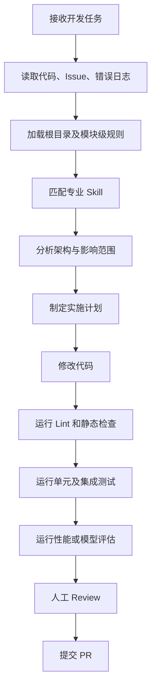

# AI Infra 工程规范与 Coding Agent 配置调研

调研范围：训练、推理、分布式基础设施、Kernel / Operator / Compiler，以及 Claude Code、Codex、Cursor、GitHub Copilot 的配置与工作流程。

资料基准日期：2026-11-24。引用主要指向 GitHub `main` / `master` 分支，未固定 commit。标注“待核实”的项目仅表示资料不充分；静态文档检查不代表已运行测试或复现性能结果。

## 目录

- [1. 调研目标与方法](#section-1)
- [2. 总体结论](#section-2)
- [3. 训练框架](#section-3)
- [4. 推理框架](#section-4)
- [5. 分布式计算与基础设施](#section-5)
- [6. Kernel、算子与编译器](#section-6)
- [7. Coding Agent 配置体系](#section-7)
- [8. 共享规范与工具适配](#section-8)
- [9. 开发流程与验证要求](#section-9)
- [10. 项目对比与实践清单](#section-10)
- [11. 参考资料](#section-11)
- [12. 实施建议](#section-12)

<a id="section-1"></a>

## 1. 调研目标与方法

本报告关注四类问题：

1. 主流 AI Infra 项目的代码规范、测试体系、构建与 CI 机制。
2. 项目如何通过 `AGENTS.md`、`CLAUDE.md`、Cursor Rules 等文件约束 Coding Agent。
3. 如何管理 Skills、MCP、Hooks、Subagents 与权限。
4. 如何将这些实践整合成可复用的 AI-Native Engineering Standard。

本次重点查看项目仓库中的贡献指南、Agent 指令、Lint 配置、测试目录、PR 模板和官方 Agent 文档。静态文件核查不等于实际运行 CI、Lint 或 GPU 测试。

<a id="section-2"></a>

## 2. 总体结论

AI Infra 项目的工程规范不应局限于 Python、C++、CUDA 的格式要求，而应形成一套完整的工程体系：

- **代码规范**：统一风格、类型、命名、目录与 API 约束。
- **测试与 CI**：验证功能、边界条件、跨平台兼容性和回归。
- **性能验收**：通过可复现 Benchmark 和 Profiling 证明优化有效。
- **Agent 指令**：让 Agent 理解仓库架构、工作流程和禁止事项。
- **Skills**：把专业任务流程封装成可复用操作手册。
- **工具与自动化**：通过 MCP、Hooks 和 Subagents 扩展能力。
- **安全与人工责任**：管理权限、密钥、集群资源和最终 Review。

### 2.1 值得优先学习的项目

| 优先级 | 项目 | 主要学习方向 |
| --- | --- | --- |
| P0 | vLLM、Megatron-LM、Transformers、PyTorch | 工程治理、Agent 工作流、测试与人工责任 |
| P1 | FlashInfer、TileLang、TVM、SGLang | Kernel 正确性、性能验收、编译器与专业知识注入 |
| P2 | Kubernetes、Ray、Triton、CUTLASS | 多模块协作、代码生成、API 稳定性、分布式测试和多后端 |

<a id="section-3"></a>

## 3. 训练框架

训练框架的核心工程挑战包括分布式执行、混合精度、Checkpoint、数据管线、并行策略、模型行为回归和多 GPU 环境。

### 3.1 PyTorch

- 仓库：[pytorch/pytorch](https://github.com/pytorch/pytorch)
- 重点文件：[AGENTS.md](https://github.com/pytorch/pytorch/blob/main/AGENTS.md)、[CLAUDE.md](https://github.com/pytorch/pytorch/blob/main/CLAUDE.md)、[AI_POLICY.md](https://github.com/pytorch/pytorch/blob/main/AI_POLICY.md)

主要实践：

- 多语言工程需要分层管理，不应把 Python 规范机械套用到 C++、CUDA 和构建系统。
- 测试应覆盖算子行为、设备差异、边界输入和回归场景。
- CI 通常需要按平台、设备、构建类型和测试成本分层。
- AI 生成代码仍须由人类作者理解、验证并负责。
- Agent 指令与 AI 使用政策应明确区分：前者指导工作，后者约束贡献责任。

### 3.2 Megatron-LM

- 仓库：[NVIDIA/Megatron-LM](https://github.com/NVIDIA/Megatron-LM)
- 重点文件：[AGENTS.md](https://github.com/NVIDIA/Megatron-LM/blob/main/AGENTS.md)、[贡献指南](https://github.com/NVIDIA/Megatron-LM/blob/main/docs/developer/contribute.md)

主要实践：

- 任务开始前先阅读 Issue、相关代码、错误日志和模块文档。
- 根据任务类型加载专业 Skill，而不是将所有知识塞入根级指令。
- 分布式训练测试应明确 GPU 数量、节点数、并行策略和启动方式。
- Checkpoint、数据并行、张量并行和流水线并行相关修改，需要有针对性的回归验证。
- 大型训练任务应区分快速验证与昂贵的完整验证。

### 3.3 Hugging Face Transformers 与 TRL

- Transformers：[huggingface/transformers](https://github.com/huggingface/transformers)
- TRL：[huggingface/trl](https://github.com/huggingface/trl)
- 重点文件：[Transformers .ai/AGENTS.md](https://github.com/huggingface/transformers/blob/main/.ai/AGENTS.md)、[TRL CONTRIBUTING.md](https://github.com/huggingface/trl/blob/main/CONTRIBUTING.md)

主要实践：

- 使用共享规则源，避免 Claude、Codex、Cursor 各维护一份相互冲突的业务规范。
- 将通用规则、模型开发规则和具体任务流程分层。
- Skills 适合封装模型适配、测试、文档、性能分析等多步骤工作。
- 通过贡献指南明确 PR、测试和文档更新要求。

<a id="section-4"></a>

## 4. 推理框架

推理框架除了模型执行，还需要处理请求调度、并发、KV Cache、显存管理、批处理、模型评估和服务稳定性。

### 4.1 vLLM

- 仓库：[vllm-project/vllm](https://github.com/vllm-project/vllm)
- 重点文件：[AGENTS.md](https://github.com/vllm-project/vllm/blob/main/AGENTS.md)、[Agent 指令维护指南](https://github.com/vllm-project/vllm/blob/main/docs/contributing/editing-agent-instructions.md)

主要实践：

- 使用统一 Python 环境管理方式，例如 uv 和项目虚拟环境。
- 测试设计应明确模块职责、输入输出契约、目标故障和最低成本测试层级。
- 正确性测试与性能 Benchmark 分离；Kernel 性能测试放在专门 Benchmark 目录。
- 修改模型行为时，应提供相应模型评估。
- 根级 `AGENTS.md` 保持精简，领域知识下沉到 Domain Guides。
- Agent 指令应避免重复、冲突和无效规则；单次事故优先修代码、CI 或测试，而不是不断堆叠 Prompt。

### 4.2 SGLang

- 仓库：[sgl-project/sglang](https://github.com/sgl-project/sglang)
- 重点文件：[docs/AGENTS.md](https://github.com/sgl-project/sglang/blob/main/docs/AGENTS.md)

主要实践：

- 文档中的 CLI 参数、环境变量默认值和实际行为必须有可靠依据。
- 优先从当前仓库实现和官方文档确认技术事实。
- 示例应可复制执行，并说明平台、模型、并行参数和必要环境。
- NVIDIA CUDA、ROCm、XPU、Ascend 等平台差异需要明确标注。
- 文档 Agent 的约束可推广到模型适配、部署配置和环境变量文档。

### 4.3 其他推理框架

| 项目 | 仓库 | 建议研究方向 | Agent 文件状态 |
| --- | --- | --- | --- |
| TensorRT-LLM | [NVIDIA/TensorRT-LLM](https://github.com/NVIDIA/TensorRT-LLM) | C++、CUDA、构建、插件和模型执行 | 待专项核实 |
| LightLLM | [ModelTC/LightLLM](https://github.com/ModelTC/LightLLM) | Python、调度、服务端资源管理 | 待专项核实 |
| LMDeploy | [InternLM/lmdeploy](https://github.com/InternLM/lmdeploy) | 多后端、模型部署和测试 | 待专项核实 |
| llama.cpp | [ggml-org/llama.cpp](https://github.com/ggml-org/llama.cpp) | C/C++、跨硬件后端和编译测试 | 待专项核实 |

<a id="section-5"></a>

## 5. 分布式计算与基础设施

Infra 项目除了代码质量，还需要管理生成代码、API 稳定性、依赖更新、分布式状态、故障恢复、测试集群和高风险操作。

### 5.1 Kubernetes

- 仓库：[kubernetes/kubernetes](https://github.com/kubernetes/kubernetes)
- 重点文件：[AGENTS.md](https://github.com/kubernetes/kubernetes/blob/master/AGENTS.md)

已整理的 Agent 约束包括：

- 生成文件不能手工修改，应通过项目规定的生成流程更新。
- 依赖更新应遵循仓库指定流程，不应随意执行可能改变大量依赖的命令。
- 明确 staging 源码位置和 API 权威来源。
- Go 文件需要符合项目 License Header 要求。
- AI 贡献应披露，最终提交内容由人类作者负责。

值得推广：Agent 必须知道哪些文件是生成产物、哪些 API 是稳定接口、哪些依赖需要专门工具更新。

### 5.2 Ray

- 仓库：[ray-project/ray](https://github.com/ray-project/ray)
- 重点文件：[AGENTS.md](https://github.com/ray-project/ray/blob/master/AGENTS.md)

主要实践：

- 多语言目录边界清晰，Python API 与 C++ Core 分层。
- 通过 DCO、贡献流程和 CI 管理贡献质量。
- 避免重复 PR、无价值机械改动和作者无法解释的 Agent 生成代码。
- Agent 指令本身也应经过 Review，不能任意自我修改。

### 5.3 其他 Infra 项目

| 项目 | 仓库 | 建议研究方向 |
| --- | --- | --- |
| Volcano | [volcano-sh/volcano](https://github.com/volcano-sh/volcano) | 调度器、CRD、Kubernetes API |
| KubeRay | [ray-project/kuberay](https://github.com/ray-project/kuberay) | Operator、CRD、E2E |
| DeepSpeed | [deepspeedai/DeepSpeed](https://github.com/deepspeedai/DeepSpeed) | 分布式训练 Infra |

<a id="section-6"></a>

## 6. Kernel、算子与编译器

Kernel 工程需要同时验证源代码质量、编译行为、数值正确性和性能。编译成功不代表数值正确，数值正确也不代表性能达标。

建议将规范分成四层：

1. 源代码规范。
2. 编译与代码生成规范。
3. 数值正确性规范。
4. 性能验收规范。

### 6.1 FlashInfer

- 仓库：[flashinfer-ai/flashinfer](https://github.com/flashinfer-ai/flashinfer)
- 重点入口：[CLAUDE.md](https://github.com/flashinfer-ai/flashinfer/blob/main/CLAUDE.md)、[仓库 README](https://github.com/flashinfer-ai/flashinfer)

主要实践：

- 性能优化 PR 应提供可复现 Benchmark。
- 报告 GPU 型号、输入规模、绝对 Latency 和优化前后数据。
- 正确性与性能验证应分开呈现。
- 使用 Self-review Skill 和人工 Review 指南辅助审查。
- GPU 测试成本较高时，可以采用定向测试触发机制，而不是每次运行全量测试。

Benchmark 报告示例（仅为格式示意，非项目实测数据）：

```text
Kernel: Decode
GPU: NVIDIA H100 SXM
Dtype: BF16
Batch Size: 128
Head Dimension: 128
KV Length: 8192

Baseline Latency: 0.85 ms
Optimized Latency: 0.62 ms
Speedup: 1.37x

Correctness: PASS
Benchmark: <reproducible command>
```

### 6.2 TileLang

- 仓库：[tile-ai/tilelang](https://github.com/tile-ai/tilelang)
- 重点文件：[CONTRIBUTING.md](https://github.com/tile-ai/tilelang/blob/main/CONTRIBUTING.md)、[pyproject.toml](https://github.com/tile-ai/tilelang/blob/main/pyproject.toml)、[requirements-lint.txt](https://github.com/tile-ai/tilelang/blob/main/requirements-lint.txt)

主要实践：

- Python 使用 Ruff 等工具进行格式和 Lint 管理。
- C/C++ 使用 clang-format。
- pre-commit 统一执行检查。
- pytest 组织测试。
- C++ API 风格可通过专门审计脚本辅助检查。
- Python、C++、编译器 API 应分别治理，避免用一套规则覆盖所有语言和抽象层。

### 6.3 Triton

- 仓库：[triton-lang/triton](https://github.com/triton-lang/triton)
- 重点文件：[CONTRIBUTING.md](https://github.com/triton-lang/triton/blob/main/CONTRIBUTING.md)

主要实践：

- Compiler Core、Backend、Interpreter、Profiler 和 Extension 应有清晰边界。
- 模块可以独立演进，并由相应维护者负责。
- 硬件 Backend 可以根据项目治理方式独立维护。
- 多后端项目需要明确模块责任和兼容性边界。

### 6.4 Apache TVM

- 仓库：[apache/tvm](https://github.com/apache/tvm)
- 重点文件：[AGENTS.md](https://github.com/apache/tvm/blob/main/AGENTS.md)、[Code Guide](https://github.com/apache/tvm/blob/main/docs/contribute/code_guide.rst)、[Testing](https://github.com/apache/tvm/blob/main/docs/contribute/testing.rst)

主要实践：

- C++ 规范参考 Google C/C++ Style。
- 公共函数使用 Doxygen 文档。
- 使用 clang-format 和 pre-commit。
- 测试应覆盖兼容的 Target。
- 修改 IR 时应提供能证明 IR 或行为变化的测试。
- 先运行最小范围测试，再逐步扩大。
- 多 Worktree 和源码工作目录的 Python 环境应避免互相污染。

Target 参数化测试的概念示例：

```python
@pytest.mark.parametrize("target", supported_targets)
def test_operator(target):
    # compile for target
    # execute
    # validate numerical result
    ...
```

以上为概念示例，不是 TVM 仓库原始代码。

### 6.5 NVIDIA CUTLASS

- 仓库：[NVIDIA/cutlass](https://github.com/NVIDIA/cutlass)

主要目录职责：

```text
include/       # 核心 Header Library
tools/         # 工具
examples/      # 示例
test/          # 单元测试
```

主要实践：

- Header-only 库组织方式。
- Utilities、Tools、Examples 和单元测试分层。
- 单元测试可按顶层 Namespace 组织成多个二进制。
- 支持并行运行单元测试，例如 `make test_unit -j`。

CUTLASS 的专项 Agent 文件状态在前述调研中未充分核实。

### 6.6 Kernel / Compiler 项目对比

| 项目 | 语言 / 技术 | 重点规范 | Agent 核查情况 |
| --- | --- | --- | --- |
| FlashInfer | Python、CUDA、C++ | 正确性、Benchmark、性能 PR Revie | w CLAUDE.md 已核实 |
| TileLang | Python、C++、CUDA、TVM | Ruff、clang-format、pytest、C++ API | Agent 配置待核实 |
| Triton | Python、C++、MLIR、LLVM | Compiler / Backend 模块治理 | CONTRIBUTING 已核实 |
| TVM | C++、Python、Compiler IR | Google C++ Style、Target 测试 | AGENTS.md 已核实 |
| CUTLASS | C++、CUDA、Python DSL | Header Library、单元测试 | Agent 配置待核实 |

其他值得补充研究的项目：

- [ROCm Composable Kernel](https://github.com/ROCm/composable_kernel)
- [ThunderKittens](https://github.com/HazyResearch/ThunderKittens)
- [FlashAttention](https://github.com/Dao-AILab/flash-attention)
- [FlashInfer-Bench](https://github.com/flashinfer-ai/flashinfer-bench)

<a id="section-7"></a>

## 7. Coding Agent 配置体系

### 7.1 配置类型

| 类型 | 代表文件 | 核心作用 |
| --- | --- | --- |
| 通用项目指令 | `AGENTS.md` | 工程约束和工作流程 |
| Claude 指令 | `CLAUDE.md` | Claude Code 项目入口 |
| Cursor Rules | `.cursor/rules/*.mdc` | 按目录和条件加载规则 |
| Copilot Instructions | `.github/copilot-instructions.md` | Copilot 仓库指令 |
| Gemini 指令 | `GEMINI.md` | Gemini CLI 项目上下文 |
| Skills | `SKILL.md` | 可复用任务操作流程 |
| MCP | `.mcp.json` 等 | 工具和数据访问能力 |
| Hooks | Agent Hook 配置 | 执行前后自动化 |
| Subagents | Agent 专属配置 | 专业子任务分工 |

Instructions、Skills、MCP、Hooks 和 Subagents 不是同一种机制：

- Instructions：项目约束和上下文。
- Skills：任务执行方法。
- MCP：工具和外部系统连接。
- Hooks：自动化检查和动作。
- Subagents：任务分工和专业角色。

### 7.2 Claude Code

官方文档：

- [Claude Code 文档](https://code.claude.com/docs)
- [Settings](https://code.claude.com/docs/en/settings)
- [Skills](https://code.claude.com/docs/en/skills)
- [Hooks](https://code.claude.com/docs/en/hooks)
- [Subagents](https://code.claude.com/docs/en/sub-agents)

常见项目配置：

| 路径 | 作用 |
| --- | --- |
| `CLAUDE.md` | 项目指令 |
| `.claude/CLAUDE.md` | Claude 专属项目指令 |
| `.claude/rules/` | 模块级规则 |
| `.claude/settings.json` | 团队共享设置 |
| `.claude/settings.local.json` | 本地个人设置 |
| `.claude/skills/` | Skills |
| `.claude/agents/` | 自定义 Subagents |

权限设计示例：

```json
{
  "permissions": {
    "allow": [
      "Bash(uv run pytest *)",
      "Bash(pre-commit run *)",
      "Bash(make lint)"
    ],
    "deny": [
      "Read(./.env)",
      "Read(./.env.*)"
    ]
  }
}
```

示例用于说明权限设计；具体语法和可用权限应以当前 Claude Code 版本文档为准。团队共享配置不应包含个人密钥或不适合共享的授权。

### 7.3 OpenAI Codex

官方文档：

- [Codex Documentation](https://developers.openai.com/codex)
- [Configuration](https://developers.openai.com/codex/config-basic)
- [Skills](https://developers.openai.com/codex/skills)

常见配置：

| 路径 | 作用 |
| --- | --- |
| `AGENTS.md` | 仓库开发指令 |
| 子目录 `AGENTS.md` | 局部工程规则 |
| `~/.codex/config.toml` | 用户级配置 |
| `.codex/config.toml` | 项目级配置 |
| `.agents/skills/` | 可复用 Skills |

配置示例：

```toml
approval_policy = "on-request"
sandbox_mode = "workspace-write"
```

项目级配置需要考虑信任机制。对本地代码修改和测试可采用受限工作区；对 GPU 集群、云资源、外部网络和发布操作应要求显式审批。

### 7.4 Cursor

官方文档：

- [Cursor Rules](https://cursor.com/docs/rules)
- [Cursor Skills](https://cursor.com/docs/skills)
- [Cursor MCP](https://cursor.com/docs/mcp)

常见配置：

| 路径 | 作用 |
| --- | --- |
| `.cursor/rules/*.mdc` | 项目规则 |
| `AGENTS.md` | 通用 Agent 指令 |
| User Rules | 用户级规则 |
| Team Rules | 团队级规则 |

MDC 示例：

```markdown
---
description: CUDA and GPU kernel development rules
globs:
  - "csrc/**/*.cu"
  - "csrc/**/*.cuh"
  - "kernels/**/*.py"
alwaysApply: false
---

# GPU Kernel Rules

- Follow the existing kernel abstraction.
- Preserve supported dtype and layout contracts.
- Add numerical correctness tests.
- Benchmark against the existing implementation.
- Include GPU model and shape in performance reports.
- Do not modify generated source files manually.
```

`globs` 可以使规则按文件范围加载，避免每次修改都注入全部 Kernel 细节。

### 7.5 GitHub Copilot

官方文档：

- [Custom Instructions](https://docs.github.com/en/copilot/concepts/prompting-and-context/custom-instructions)
- [Customization Cheat Sheet](https://docs.github.com/en/copilot/reference/customization-cheat-sheet)

常见配置：

| 路径 | 用途 |
| --- | --- |
| `.github/copilot-instructions.md` | 仓库级规则 |
| `.github/instructions/*.instructions.md` | 路径级规则 |
| `AGENTS.md` | Agent 指令 |
| `.github/agents/*.agent.md` | 自定义 Agent |
| `.github/prompts/*.prompt.md` | 可复用 Prompt |

需要区分通用 Instructions 与 Custom Agent Definitions：前者规定工作约束，后者定义专门角色和工具范围。不同 Copilot 客户端和产品入口的支持范围可能不同，应分别验证。

### 7.6 Agent 能力对比

| 能力 | Claude Code | Codex | Cursor | GitHub Copilot |
| --- | --- | --- | --- | --- |
| 项目级指令 | CLAUDE.md | AGENTS.md | AGENTS.md / Rules | Copilot Instructions / AGENTS |
| 路径级规则 | `.claude/rules/` | 子目录 AGENTS.md | `.cursor/rules/*.mdc` | `.github/instructions/` |
| Skills | `.claude/skills/` | `.agents/skills/` | 支持 Skills | 依客户端和 Agent 入口而定 |
| MCP | 支持 | 支持 | 支持 | 依客户端和产品入口而定 |
| Hooks | 支持 | 依功能和版本核对 | 支持 | 依 Agent 环境核对 |
| Subagents / Agents | 支持 | 支持 | 支持 | 自定义 Agent |
| 权限管理 | allow / ask / deny | Approval + Sandbox | 工具和执行权限 | Agent / 工具权限 |

不同客户端和运行模式的配置加载方式可能不同，应分别验证。

<a id="section-8"></a>

## 8. 共享规范与工具适配

通用规范集中维护，各工具入口仅保留适配配置。

TRL 的 [CONTRIBUTING.md](https://github.com/huggingface/trl/blob/main/CONTRIBUTING.md) 是值得研究的实践：共享指令源与不同 Agent 的入口文件分开，避免规则重复。

### 8.1 推荐目录结构

```text
ai-infra-project/
├── AGENTS.md
├── CLAUDE.md
├── GEMINI.md
├── .ai/
│   ├── AGENTS.md
│   ├── AI_POLICY.md
│   └── architecture/
│       ├── overview.md
│       ├── training.md
│       ├── inference.md
│       ├── distributed.md
│       └── kernel.md
├── .agents/
│   └── skills/
│       ├── code-review/SKILL.md
│       ├── model-development/SKILL.md
│       ├── distributed-training/SKILL.md
│       ├── inference-development/SKILL.md
│       ├── kernel-development/SKILL.md
│       ├── kernel-optimization/SKILL.md
│       ├── compiler-development/SKILL.md
│       ├── debugging/SKILL.md
│       └── performance-analysis/SKILL.md
├── .claude/
│   ├── settings.json
│   ├── rules/
│   ├── agents/
│   └── skills/
├── .cursor/
│   └── rules/
│       ├── python.mdc
│       ├── cpp.mdc
│       ├── cuda.mdc
│       ├── distributed.mdc
│       └── testing.mdc
├── .codex/
│   └── config.toml
├── .github/
│   ├── copilot-instructions.md
│   ├── instructions/
│   ├── agents/
│   ├── prompts/
│   └── workflows/
├── python/AGENTS.md
├── csrc/AGENTS.md
├── distributed/AGENTS.md
├── kernels/AGENTS.md
├── compiler/AGENTS.md
├── tests/AGENTS.md
├── benchmarks/AGENTS.md
└── docs/AGENTS.md
```

注意：目录结构是推荐设计，不代表所有 Agent 都自动支持相同的目录继承行为。应在实际使用的 Agent 和版本中验证加载规则。

### 8.2 目录设计原则

| 层级 | 放置内容 | 维护原则 |
| --- | --- | --- |
| 根目录 | 通用工程规则 | 保持精简 |
| `.ai/` | 共享规范、架构知识 | 统一维护 |
| `.agents/skills/` | 专业开发工作流 | 按任务维护 |
| `.claude/` | Claude 专属适配 | 不重复业务规范 |
| `.codex/` | Codex 项目配置 | 仅放安全的团队设置 |
| 模块目录 | 模块级 AGENTS.md | 只写特殊约束 |

### 8.3 推荐 Skills 分层

**Level 1：通用工程 Skills**

- code-review
- testing
- debugging
- refactoring
- documentation

**Level 2：AI Infra 专业 Skills**

- distributed-training
- inference-development
- model-development
- compiler-development

**Level 3：硬件和性能 Skills**

- cuda-kernel
- triton-kernel
- hip-kernel
- kernel-benchmark
- gpu-profiling

每个 Skill 建议采用统一结构：

```text
kernel-optimization/
├── SKILL.md
├── references/
│   ├── gpu-architecture.md
│   ├── performance-metrics.md
│   └── benchmark-methodology.md
├── scripts/
│   ├── run_benchmark.sh
│   └── collect_metrics.py
└── templates/
    └── benchmark-report.md
```

`SKILL.md` 应说明适用场景、执行步骤、参考资料、标准命令和验收标准。详细硬件知识和 API 资料应放在 `references/`，不要把所有内容塞进单个 Skill 文件。

<a id="section-9"></a>

## 9. 开发流程与验证要求

### 9.1 统一研发流程



### 9.2 按任务类型设置质量门禁

| 任务类型 | 最低质量门禁 | 高级质量门禁 |
| --- | --- | --- |
| Python API | Ruff + pytest | Type Check + Integration |
| C++ 修改 | clang-format + 编译 | clang-tidy + ABI |
| CUDA Kernel | 编译 + 正确性测试 | 多 Shape + Sanitizer + Benchmark |
| Triton Kernel | 编译 + 数值测试 | 多架构 + Profiling |
| 分布式训练 | 单机测试 | 多卡、多节点、Checkpoint 恢复 |
| 推理调度 | Unit Test | 并发压力、长上下文、故障恢复 |
| 模型修改 | 单元测试 | Model Evaluation |
| Compiler IR | IR 测试 | 多 Target、代码生成和运行结果 |

### 9.3 Kernel PR 验收模板

```markdown
# Kernel PR Checklist

## 1. Operator Contract
- [ ] Input / Output definition
- [ ] Shape / Stride / Layout
- [ ] Dtype
- [ ] Supported hardware

## 2. Correctness
- [ ] Numerical correctness
- [ ] Boundary shapes
- [ ] Edge cases
- [ ] Different dtypes
- [ ] Tolerance documented

## 3. Performance
- [ ] Baseline identified
- [ ] GPU model specified
- [ ] Benchmark reproducible
- [ ] Before / after latency
- [ ] Throughput
- [ ] Profiling results

## 4. Compatibility
- [ ] CUDA / ROCm version
- [ ] Compiler version
- [ ] GPU architecture
- [ ] Fallback implementation

## 5. Review
- [ ] Tests included
- [ ] Documentation updated
- [ ] Human review completed
- [ ] AI assistance disclosed
```

<a id="section-10"></a>

## 10. 项目对比与实践清单

### 10.1 代码规范与工程体系

| 项目 | 语言 / 技术 | 代码规范重点 | 测试 / CI 重点 | Agent 文件核查情况 |
| --- | --- | --- | --- | --- |
| PyTorch | Python / C++ CUDA | / 多语言工程治理 | 多层测试和构建矩阵 | AGENTS / CLAUDE / AI_POLICY 入口 |
| Megatron-LM | Python / CUDA | 分布式训练流程 | 多 GPU 测试 | AGENTS 已列入调研 |
| Transformers | Python | Python 工程和模型生态 | pytest / Slow Tests | `.ai/AGENTS.md` |
| vLLM | Python / C++ CUDA | / 测试设计、模型评估 | Unit / Integration E2E | / 根级 AGENTS |
| SGLang | Python / CUDA / C++ | 文档事实验证、多平台 | 多平台测试 | 文档级 AGENTS |
| Kubernetes | Go | 生成代码、依赖、API、License | Unit / Integration Verify | / 根级 AGENTS |
| Ray | Python / C++ | 分布式系统、贡献治理 | 多层测试和 CI | 根级 AGENTS |
| FlashInfer | Python / CUDA / C++ | Kernel 正确性与性能 Review | 定向 GPU 测试和 Benchmark | CLAUDE.md |
| TileLang | Python / C++ CUDA | / Ruff、clang-format、C++ API | pytest / pre-commit | Agent 配置待核实 |
| Triton | Python / C++ MLIR | / Compiler / Backend 模块边界 | 多后端测试 | CONTRIBUTING 已核实 |
| TVM | C++ / Python IR | / C++ Style、Target 测试 | Target Parametrization | AGENTS.md |
| CUTLASS | C++ / CUDA | Header Library 和测试组织 | 多测试二进制 | Agent 配置待核实 |

### 10.2 十项参考实践

| 排名 | 实践 | 参考项目 |
| --- | --- | --- |
|  | 1 AI 贡献必须有人类理解和负责 | PyTorch |
|  | 2 Agent 先读取任务上下文，再加载 Skill | Megatron-LM |
|  | 3 多 Agent 使用统一规则源 | Transformers / TRL |
|  | 4 根级指令精简，专业规则下沉 | vLLM |
|  | 5 测试必须有明确行为和失败场景 | vLLM |
|  | 6 Kernel PR 必须提供性能数据 | FlashInfer |
|  | 7 文档参数必须由源码和官方资料验证 | SGLang |
|  | 8 生成文件禁止手工修改 | Kubernetes |
|  | 9 多硬件 Target 必须验证数值正确性 | TVM |
| 1 | 0 Agent 配置自身也必须经过 Review | Ray |

<a id="section-11"></a>

## 11. 参考资料

### 11.1 训练与推理

| 项目 | 原始资料 |
| --- | --- |
| PyTorch | [AGENTS.md](https://github.com/pytorch/pytorch/blob/main/AGENTS.md)、[CLAUDE.md](https://github.com/pytorch/pytorch/blob/main/CLAUDE.md)、[AI_POLICY.md](https://github.com/pytorch/pytorch/blob/main/AI_POLICY.md) |
| Megatron-LM | [AGENTS.md](https://github.com/NVIDIA/Megatron-LM/blob/main/AGENTS.md)、[CONTRIBUTING](https://github.com/NVIDIA/Megatron-LM/blob/main/docs/developer/contribute.md) |
| Transformers | [.ai/AGENTS.md](https://github.com/huggingface/transformers/blob/main/.ai/AGENTS.md) |
| TRL | [CONTRIBUTING.md](https://github.com/huggingface/trl/blob/main/CONTRIBUTING.md) |
| vLLM | [AGENTS.md](https://github.com/vllm-project/vllm/blob/main/AGENTS.md)、[Agent Guide](https://github.com/vllm-project/vllm/blob/main/docs/contributing/editing-agent-instructions.md) |
| SGLang | [docs/AGENTS.md](https://github.com/sgl-project/sglang/blob/main/docs/AGENTS.md) |

### 11.2 基础设施

| 项目 | 原始资料 |
| --- | --- |
| Kubernetes | [AGENTS.md](https://github.com/kubernetes/kubernetes/blob/master/AGENTS.md) |
| Ray | [AGENTS.md](https://github.com/ray-project/ray/blob/master/AGENTS.md) |
| Volcano | [CONTRIBUTING.md](https://github.com/volcano-sh/volcano/blob/master/CONTRIBUTING.md) |
| KubeRay | [GitHub Repository](https://github.com/ray-project/kuberay) |

### 11.3 Kernel 与编译器

| 项目 | 原始资料 |
| --- | --- |
| FlashInfer | [CLAUDE.md](https://github.com/flashinfer-ai/flashinfer/blob/main/CLAUDE.md)、[README](https://github.com/flashinfer-ai/flashinfer) |
| TileLang | [CONTRIBUTING.md](https://github.com/tile-ai/tilelang/blob/main/CONTRIBUTING.md)、[pyproject.toml](https://github.com/tile-ai/tilelang/blob/main/pyproject.toml) |
| Triton | [CONTRIBUTING.md](https://github.com/triton-lang/triton/blob/main/CONTRIBUTING.md) |
| TVM | [AGENTS.md](https://github.com/apache/tvm/blob/main/AGENTS.md)、[Code Guide](https://github.com/apache/tvm/blob/main/docs/contribute/code_guide.rst)、[Testing](https://github.com/apache/tvm/blob/main/docs/contribute/testing.rst) |
| CUTLASS | [GitHub Repository](https://github.com/NVIDIA/cutlass) |

### 11.4 Agent 官方文档

| Agent | 原始资料 |
| --- | --- |
| Claude Code | [Settings](https://code.claude.com/docs/en/settings)、[Skills](https://code.claude.com/docs/en/skills)、[Hooks](https://code.claude.com/docs/en/hooks)、[Subagents](https://code.claude.com/docs/en/sub-agents) |
| Codex | [Codex Docs](https://developers.openai.com/codex)、[Configuration](https://developers.openai.com/codex/config-basic)、[Skills](https://developers.openai.com/codex/skills) |
| Cursor | [Rules](https://cursor.com/docs/rules)、[Skills](https://cursor.com/docs/skills)、[MCP](https://cursor.com/docs/mcp) |
| GitHub Copilot | [Custom Instructions](https://docs.github.com/en/copilot/concepts/prompting-and-context/custom-instructions)、[Customization Cheat Sheet](https://docs.github.com/en/copilot/reference/customization-cheat-sheet) |

<a id="section-12"></a>

## 12. 实施建议

1. 整理现有代码规范、测试命令与贡献指南，建立简短的共享 Agent 指令。
2. 选择模型接入、分布式调试、Kernel 开发等高频任务编写 Skills。
3. 将格式、构建、数值与兼容性检查接入 CI，按任务安排性能测试。
4. 在 PR 中记录实际命令、结果、未执行项及原因，按项目政策披露 AI 使用。
5. 定期检查各工具入口、规则加载方式和引用文档，删除重复或过时要求。
