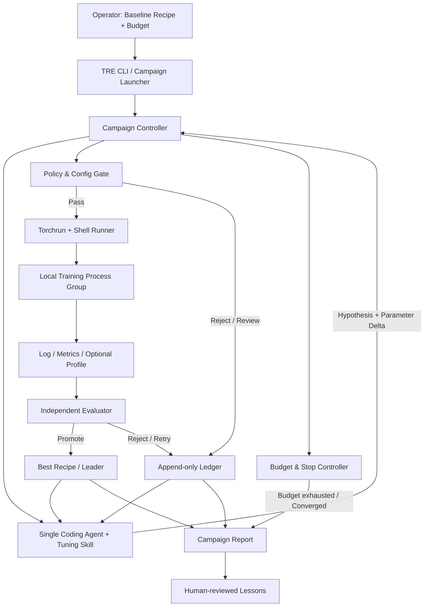
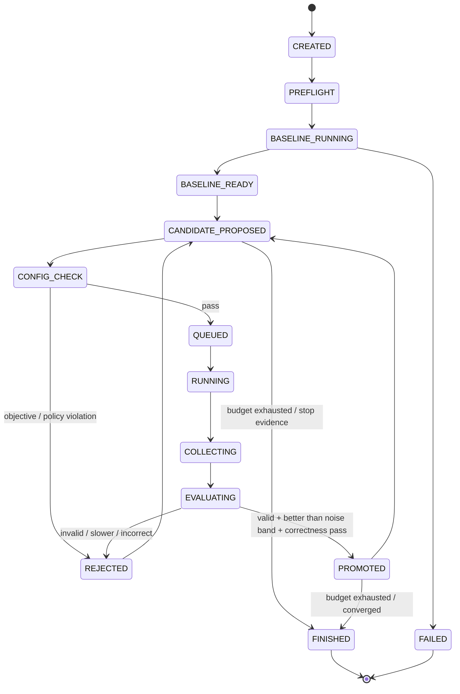

# Training RSI Engine（MVP）架构设计

> 目标：参考 Amazon ATTUNE 的工程思路，构建一个小而可运行的 LLM Training Throughput RSI。输入一个已经能正常训练的 Recipe 和 GPU-hour 预算，Agent 自动诊断瓶颈、提出优化、执行实验、独立评估，并产出通过正确性检查的最快 Recipe。
>
> 版本：MVP 设计稿 v0.2
> 范围：只做训练吞吐优化；推理优化、自动 Kernel 生成、多 Agent 协作均不纳入第一版。

本文为未来训练 Runtime 的设计草案，不代表当前仓库已实现这些能力。当前共享资源与验证工具的职责仍以 [RSI 设计](../RSI_DESIGN.md) 为准。

---

## 1. 产品定位与成功标准

### 1.1 产品定位

Training RSI Engine（TRE）在已有训练框架上组织吞吐优化实验，各组件分工如下：

- 训练框架负责正确地训练模型；
- Coding Agent 负责分析、提出假设和修改候选 Recipe；
- TRE Control Plane 负责运行作业、计量 GPU 成本、收集结果和维护状态；
- 独立 Evaluator 负责判定实验是否有效、是否正确、是否值得晋级。

Agent 提交候选，确定性评估逻辑依据固定契约决定是否晋级；共享经验仍由人工审核。

### 1.2 MVP 的输入与输出

输入：

1. 一个已知可运行的训练 Recipe；
2. 模型、数据集、tokenizer、训练目标和硬件信息；
3. 可复现的 Benchmark Workload；
4. GPU-hour / trial 数量 / 单次运行超时预算；
5. 参数白名单；初版源码目录保持只读。

输出：

1. `best_recipe.yaml`：通过验证的最佳配置；
2. `best.patch`：相对基线的配置差异；源码改动扩展启用后才包含代码变更；
3. `campaign_report.md`：基线、候选、指标、结论和成本；
4. `ledger.jsonl`：追加式实验记录，结合摘要和 wrapper 记录核对完整性；
5. `lessons.proposed.md`：候选经验，需人工审核后进入共享知识库。

### 1.3 MVP 验收标准

一次完整 Campaign 至少满足：

- 从给定 Baseline 成功完成基线测量；
- Agent 至少提出并执行一个有明确假设的候选实验；
- 所有候选使用相同的数据、模型、GPU 数量和评分窗口；
- 无效日志、OOM、超时和不完整训练不会被计为有效性能结果；
- 训练目标相关配置变更会被拒绝或进入人工审核；
- 只有超过噪声阈值并通过正确性 Gate 的候选才能成为 Leader；
- 达到预算或收敛条件后停止，并输出可复现报告；
- 中断后可从 Ledger 恢复，不重复扣费或错误晋级。

---

## 2. MVP 范围

### 2.1 第一版做什么

| 能力 | MVP 范围 |
|---|---|
| 基线 Recipe 导入 | 必须 |
| 参数级优化 | 必须，先做白名单参数 |
| 训练日志解析 | 必须 |
| 吞吐 Benchmark | 必须 |
| 基础 Profiling | 按需执行，不要求每次实验都 Profiling |
| Candidate 对比与 Leader 管理 | 必须 |
| 配置正确性 Gate | 必须 |
| Loss / 数值 sanity check | 必须 |
| GPU-hour 预算 | 必须 |
| Campaign 恢复 | 必须 |
| 经验记录 | 必须，但先人工审核后沉淀 |
| 局部代码 Patch | 初版关闭；补齐对应行为验证后按独立扩展开放 |

### 2.2 范围限制

- Training + Inference 双域统一平台；
- 多 Agent Swarm、Agent 间复杂协商；
- 自动修改自身 Skill、Evaluator 或预算规则；
- 通用超参数优化平台；
- 自动生成任意 CUDA/Triton Kernel；
- 跨 GPU 厂商、跨训练框架的通用适配；
- Web UI、微服务化、分布式任务编排平台；
- 自动把未经审核的经验写入全局知识库。

### 2.3 首个运行环境

沿用已有训练环境，初版选定以下组合：

- 硬件：NVIDIA H100（先固定一种 GPU 型号）；
- 框架：Megatron-LM；
- 工作负载：一个确定的 SFT Recipe；
- 执行：本机或专用 GPU 机器上的 `torchrun + Bash`；
- Agent：Claude Code 或 Codex，只接入一个；
- 运行方式：单机优先、单 Campaign、单候选串行执行（`max_concurrent_runs=1`）。

**MVP 不引入 KubeRay、RayJob、Slurm 或 Kubernetes Job。** Python Controller 通过 Shell Runner 启动训练脚本，Shell 脚本通过 `torchrun` 启动分布式训练进程。第一版假设 GPU 已由使用者预先分配给本 Campaign；`torchrun` 负责分布式进程启动和 rendezvous，不负责 GPU 资源排队、机器分配或集群级隔离。

---

## 3. 总体架构

采用 **Single Agent + Deterministic Control Plane + Independent Evaluator**。



### 3.1 组件职责

| 组件 | 职责 | 是否允许 Agent 修改 |
|---|---|---|
| Campaign Controller | 状态机、任务分配、实验生命周期 | 否 |
| Tuning Skill | 搜索策略、实验纪律、领域知识 | Campaign 内只读 |
| Coding Agent | 诊断瓶颈、提出假设、生成 Candidate | 只能修改候选工作区 |
| Config Gate | 检查目标约束和变更分类 | 否 |
| Torchrun Shell Runner | 生成启动参数、启动/监控/终止本地训练进程组、收集日志 | 否 |
| Metrics Collector | 从训练日志提取指标 | 否 |
| Evaluator | 校验运行、计算分数、晋级/拒绝 | 否 |
| Budget Manager | 计算 GPU-hour、阻止超预算启动 | 否 |
| Ledger | 记录每次实验与状态变更 | 只能追加 |
| Lever Catalog | 记录参数机制、适用条件和失败模式 | 只能提交候选经验，审核后合并 |

**MVP 不需要 LangGraph、CrewAI、Temporal、Kafka、Redis、PostgreSQL 或独立 Agent Server。** 一个 Python CLI、一个 Coding Agent 进程、文件系统和训练集群即可。

---

## 4. Campaign 工作流

### 4.1 Campaign 生命周期

状态机中的 `QUEUED` 只是 Controller 内部的待执行状态，不代表存在 Slurm/Kubernetes 一类的外部任务队列。MVP 通过 Campaign Lock 和 `max_concurrent_runs=1` 保证同一机器上最多只有一个 TRE Run 在执行。



### 4.2 一次 Candidate 的完整流程

1. Agent 读取当前 Leader、历史 Ledger、Profiling 摘要和 Lever Catalog。
2. Agent 提出一个可证伪的性能假设。
3. Agent 创建 Candidate：优先只改变一个参数；只有明确耦合的参数才允许组合变更。
4. Config Gate 对比 Baseline 和 Candidate 的**解析后配置**，检查是否改变训练目标。
5. Controller 检查 GPU-hour、并发数、超时和本机执行权限策略。
6. Torchrun Shell Runner 使用与 Baseline 相同的 Workload 和 GPU 可见设备集合启动训练进程。
7. Collector 监控本地进程退出状态，收集 stdout/stderr、Resolved Config、Loss、Step Time 和必要的 Profile。
8. Evaluator 检查运行完整性、指标有效性、Correctness 和性能增益。
9. 通过则 Candidate 晋级为 Leader；否则保留记录但不覆盖 Leader。
10. Agent 根据结果诊断下一轮，直到预算用完或明确收敛。

### 4.3 Candidate 必须提交假设

每个候选实验都要有结构化说明，禁止“试试这个参数看看”。

```yaml
candidate_id: exp-0007
parent: leader-0003
hypothesis:
  bottleneck: communication_tail
  evidence:
    - "nsys trace: all_reduce overlaps poorly with backward compute"
  change:
    - key: overlap_grad_reduce
      from: false
      to: true
  mechanism: "Overlap gradient communication with backward computation"
  expected_gain_pct: 5.0
  confidence: medium
  risk: medium
  estimated_gpu_hours: 0.5
validation:
  - config_gate
  - training_smoke_test
  - throughput_benchmark
```

Agent 必须先阅读当前训练镜像/代码版本中该参数的实际实现，确认副作用、默认值和与其他参数的覆盖关系，并把源码位置写入记录。

---

## 5. 模块职责

### 5.1 Campaign Controller

职责：

- 创建 Campaign 并冻结配置；
- 启动 Agent 会话；
- 接受 Agent 的 Candidate；
- 调用 Config Gate、Runner 和 Evaluator；
- 管理状态转移、Budget 和 Stop 条件；
- 中断后从 Ledger 恢复。

Controller 采用本地 Python 模块。同一 `attempt_id` 的启动与结算必须幂等；同一 Candidate 的真实重跑创建新的 attempt，分别计量资源消耗。

### 5.2 Agent / Tuning Skill

第一版只用一个 Coding Agent。Skill 约束它的工作方式：

- 先读 Baseline、当前 Leader、历史实验和 Lever Catalog；
- 先提出诊断与假设，再修改配置；
- 一次只改变一个 Lever 或一组明确耦合的参数；
- 先读参数的真实源码，不凭印象修改；
- 不允许修改数据、训练目标、Evaluator、预算、Ledger 或 Harness；
- 不允许 Agent 绕过 Controller 直接启动 GPU 训练进程；
- 不允许自行宣布某个候选成功；
- 失败、OOM、超时也必须记录原因和成本。

Skill 是 Agent 的搜索策略与领域知识载体，不是可信执行边界。真正的权限限制由运行账户、工作区权限、GPU 可见设备集合和进程控制边界执行。

### 5.3 Torchrun + Shell Runner

第一版不实现集群 Scheduler Adapter，只实现一个 `TorchrunShellRunner`。Python Controller 负责生命周期和预算，Shell 脚本负责准备环境并启动 `torchrun`，不把调度职责交给 Agent。

职责边界：

- Python Runner：校验 GPU 可见设备集合、构造受控环境变量、启动 Shell、记录 PID/PGID、监控退出码和超时、发送终止信号、计算 GPU-hour；
- Shell Script：激活训练环境、设置训练所需环境变量、调用 `torchrun`、将训练程序的退出码原样返回；
- `torchrun`：启动每张 GPU 对应的训练进程，并负责 PyTorch 分布式 rendezvous；
- 训练框架：执行实际训练并输出训练指标。

**注意：`torchrun` 不是资源调度器。** 它不会为任务分配 GPU，也不会在多用户机器上提供 GPU 隔离。MVP 默认在专用机器或已预分配 GPU 的环境运行；通过 `CUDA_VISIBLE_DEVICES` 固定本次实验可用 GPU，并将 `max_concurrent_runs` 固定为 1。不要在共享 GPU 主机上仅靠 `nvidia-smi` 的空闲显存判断来实现安全抢占。

启动脚本目录：

```text
scripts/
├── run_training.sh       # 唯一训练启动入口
├── preflight.sh          # GPU、torch、CUDA、torchrun 检查
└── terminate_run.sh      # 可选：人工紧急停止入口
```

`run_training.sh` 示例（以单机为默认模式）：

```bash
#!/usr/bin/env bash
set -Eeuo pipefail

: "${GPU_COUNT:?GPU_COUNT is required}"
: "${TRAIN_ENTRYPOINT:?TRAIN_ENTRYPOINT is required}"
: "${RECIPE_PATH:?RECIPE_PATH is required}"

exec torchrun \
  --standalone \
  --nnodes=1 \
  --nproc_per_node="${GPU_COUNT}" \
  "${TRAIN_ENTRYPOINT}" \
  --config "${RECIPE_PATH}"
```

Controller 通过 `subprocess.Popen([...], start_new_session=True, ...)` 启动受信任的 Run wrapper，wrapper 再调用训练脚本，stdout/stderr 写入当前 attempt 的日志。命令使用参数列表，不通过 `shell=True` 拼接 Agent 文本。wrapper 在启动 Worker 前持久化自身身份并持有设备执行锁，独立执行 deadline、进程组终止和退出记录；恢复协议见第 9.3 节。终止时先发送 `SIGTERM`，宽限期后再发送 `SIGKILL`，确认 Worker 退出后才结算并释放执行锁。

为避免两个 TRE Campaign 意外同时占用同一组 GPU，Controller 启动时应获取 Campaign Host Lock（Linux 可使用 `fcntl.flock`），并在整个 Campaign 生命周期内持有。该锁只协调 Controller，不能保护 Controller 崩溃后仍运行的作业；Run wrapper 另持有按已分配 GPU 集合统一定位的执行锁，直到 Worker 清理完成。`CUDA_VISIBLE_DEVICES` 只是限制当前进程可见哪些 GPU，不会预留或锁定 GPU；GPU ID 必须来自使用者预先分配的配置。

Runner 接口：

```python
class TrainingRunner(Protocol):
    def preflight(self, recipe: Path) -> PreflightResult: ...
    def resolve_config(self, recipe: Path) -> dict: ...
    def start(self, run_spec: RunSpec) -> RunningProcess: ...
    def poll(self, run: RunningProcess) -> RunStatus: ...
    def terminate(self, run: RunningProcess, grace_seconds: int = 30) -> None: ...
    def collect(self, run: RunningProcess) -> RunArtifacts: ...
```

`RunSpec` 至少包含 `run_id`、`attempt_id`、请求摘要、`recipe_path`、候选内容摘要、`gpu_ids`、`gpu_count`、包含终止清理的 deadline、`env_allowlist` 和 `log_dir`。Runner 只负责执行与采集，不负责性能判定。

如果后续确实需要多节点，仍可通过 Shell 启动 `torchrun`：显式传入 `--nnodes`、`--node_rank`、`--master_addr`、`--master_port`，并要求所有节点已由外部人工或基础设施预先分配。多节点协同启动、节点故障恢复和资源排队不纳入本 MVP。

沿用已有 Recipe 的训练入口和数据管线，复制 Baseline 后只覆盖获准参数。

### 5.4 Metrics Collector

从训练日志和框架输出中提取：

- step id；
- 每 step 的 elapsed time；
- processed tokens；
- loss tokens（如果可获得）；
- train loss、grad norm；
- GPU 数量、节点数；
- OOM / exception / worker restart；
- 训练最终完成 step；
- resolved arguments。

原始日志必须保留；解析结果应写成 `metrics.json`，不可只保留 Agent 的文字总结。

### 5.5 Profiler

MVP 不需要每次实验都运行 Profiler。先使用训练日志确定大致瓶颈；只有瓶颈不清楚、或优化进入平台期时才触发 Profiling。

初版使用以下工具：

- NVIDIA 环境：Nsight Systems（优先看计算/通信/CPU Launch 时间线）；
- 先不做复杂 Nsight Compute 自动调优；
- 将 Profile 产物和分析摘要交给 Agent，由 Agent 形成下一轮假设。

---

## 6. 测量协议

### 6.1 固定 Workload Contract

一个 Campaign 内以下内容必须保持不变：

- model checkpoint / model revision；
- tokenizer 和 chat template；
- dataset 文件及 SHA256；
- 数据行顺序、采样和 seed；
- sequence length / packing 规则；
- global batch size；
- optimizer、学习率和 scheduler；
- loss mask 和训练目标；
- precision 语义；
- GPU 型号、GPU 总数和软件镜像；
- Benchmark step 数和测量窗口。

如果某个配置变化会改变上述语义，则不能当作普通性能优化候选。

### 6.2 Baseline 标定

先重复运行 Baseline，记录环境与噪声：

- MVP 开发期至少 3 次；
- 正式 Campaign 可运行 5 次，固定预分配设备并使用独立进程；更换设备时分组报告，不混入同一噪声基线；
- 记录平均值、标准差、变异系数和每次原始指标；
- 根据 Baseline 的噪声设定判定阈值。

可参考 ATTUNE 的决策方式：噪声阈值取 `max(3%, 3 × relative_stddev)`。若候选提升未超过阈值，只能判为 tie / inconclusive，不应晋级。

### 6.3 吞吐指标

记录以下两种吞吐口径：

```text
processed_tokens_per_sec_per_gpu
  = measured_window_processed_tokens
    / measured_window_wall_time_seconds
    / gpu_count

loss_tokens_per_sec_per_gpu
  = measured_window_loss_tokens
    / measured_window_wall_time_seconds
    / gpu_count
```

主指标由具体训练任务指定，不能在 Campaign 中途切换口径。对于固定长度 SFT，processed tokens 和 loss tokens 可能不同，必须明确采用哪个作为优化目标。

窗口吞吐按总 Token 数除以总耗时计算，不平均各 step 的吞吐率。

### 6.4 Benchmark 测量窗口

推荐初始协议：

- 每次短跑 20 optimizer steps；
- 前 5 steps 作为 Warm-up；
- 使用 step 5–19 计分；
- Profile run 与普通 Benchmark run 分开，不用 Profile run 直接做最终排名；
- 若训练框架编译、初始化或数据预热时间较长，应先用实测结果调整步数。

步数与预热策略写入 Campaign Manifest，候选执行同一协议。

### 6.5 Leader 判定

主指标为越高越好的吞吐，定义 `gain = S_candidate / S_leader - 1`；两项分数须为有限正数，`band` 是测量前确定的非负噪声阈值。

按以下顺序判定：

1. 运行、指标或必需证据无效/不完整：`INVALID`。
2. 正确性 Gate 失败：`REJECTED_CORRECTNESS`；必需检查未运行、阻塞或无定论时保留状态，不晋级。
3. `gain < -band`：`REJECTED_SLOWER`。
4. `abs(gain) <= band`：`TIE`。
5. `gain > band` 且全部必需 Gate 通过：`PROMOTED`。

搜索中晋级仅代表暂定 Leader。结束前在保留预算内，对 Baseline 与最佳 Candidate 做独立、交错的确认性复测，按相同协议重新判断。未复现收益、预算不足或结果不完整时，不输出“已验证加速”；报告保留基线、候选和失败原因。

---

## 7. 正确性验收

训练进程成功退出不代表训练目标没有被改变。Correctness Gate 必须运行在 Agent 之外。

### 7.1 第一层：配置变更分类

比较 Baseline 与 Candidate 的**解析后配置**，而不是只对比 YAML 文本。配置项分为三类：

| 类别 | 含义 | MVP 处理 |
|---|---|---|
| `forbidden` | 改变训练目标或工作负载 | 直接拒绝 |
| `allowlisted` | 已验证不改变数学目标的性能配置 | 允许进入 Benchmark |
| `unknown` | 语义不清楚或未验证 | 默认拒绝；开发者显式审核后才允许实验 |

典型 `forbidden` 项：数据集、tokenizer、loss mask、模型权重、global batch、optimizer、learning rate / scheduler、loss term、dropout、token dropping / routing 语义、训练步数等。

典型候选 Lever：通信/计算 overlap、经过验证的同数学 Kernel Backend、Activation Recomputation、部分并行布局配置。每个 Lever 仍需在目标框架和版本上验证，不能仅凭名字认定安全。

### 7.2 第二层：训练数值检查

初版检查：

- resolved config 关键字段一致性；
- Baseline 和 Candidate 使用相同首批数据、seed、模型权重；
- 首个 optimizer update 前的 step-0 loss 对比；
- loss / grad norm 必须 finite；
- 训练必须达到预定 step 数；
- 关键 Token / Sample 计数一致。

首步 loss 只覆盖初始 forward。初版关闭源码 Patch，仅开放有目标版本验证依据的参数白名单；重计算、并行布局和同数学 backend 变更仍需使用固定数据对照短程 loss/grad norm 轨迹，按影响核对梯度或参数更新。有限值和首步 loss 接近不能单独证明 backward 正确。

后续开放 Kernel、autograd 或 optimizer 实现改动时，先定义独立 reference、梯度/参数更新对照及真实数据确认训练要求；训练语义允许变化的研究任务另建契约。容差和支持范围在候选执行前固定，缺少验证能力则阻塞该类候选。人工审批只决定允许的实验范围，不能把失败或未执行检查改成通过。

### 7.3 评估器不能被 Candidate 修改

- Evaluator 与 Gate 代码在独立只读目录；
- Agent 无权修改规则、阈值和评分脚本；
- Campaign 开始时记录这些文件的 Git Commit / SHA256；
- 运行结束再次检查 Hash；
- 检查不一致则 Campaign 失败，不能输出可晋级 Recipe。

---

## 8. 搜索策略

第一版采用 **LLM-guided sequential search**：由 Agent 判断下一步实验，不实现复杂 Bayesian Optimization 或多 Agent 投票。

搜索顺序：

1. 通信/计算重叠和框架调度参数；
2. Activation Recomputation / Memory Trade-off；
3. 在 GPU 总数不变前提下，检查 TP / PP 等并行布局的候选；
4. 已有组件测试背书的同数学 Kernel / Attention Backend；
5. 必要时分析 DataLoader、CPU Launch 或 Kernel Launch 瓶颈。

第一版先挑 3–5 个团队熟悉、参数语义清晰的 Lever。不要一开始开放全部框架参数，更不要直接允许 Agent 改数据、Batch、Optimizer 或 Precision。

搜索纪律：

- 每次实验都必须有假设；
- 原则上一次只改变一个参数；
- 组合参数必须说明它们为什么强耦合；
- 新参数必须从运行镜像的源码验证；
- 已测过的参数和值写入 Ledger，避免重复实验；
- Candidate OOM 后可以根据诊断调整一个相关内存 Lever 重试，但每次重试都计入预算；
- Agent 不得仅凭配置能启动就判定某个 Lever 有效。

---

## 9. Budget、安全与失败恢复

### 9.1 Budget Manager

至少提供：

```yaml
execution:
  mode: local_torchrun
  gpu_ids: "0,1,2,3,4,5,6,7"
  gpu_count: 8
  max_concurrent_runs: 1
  run_walltime_minutes: 45

budget:
  max_gpu_hours: 8
  max_trials: 12
  reserve_final_validation_gpu_hours: 1.0
```

GPU-hour 按本次 Run 固定分配的 GPU 数量乘以实际占用设备的运行时长（含启动与终止清理）计算：`gpu_hours = gpu_count * elapsed_seconds / 3600`。失败、OOM、超时和正确性确认运行都计入成本，不能只计算成功实验。该数字是 MVP 的资源消耗估算，不代表集群资源管理系统的计费账单。

预算包括 Baseline 标定、搜索、失败、Profiling 和最终复验。搜索的可用余额为总限额减已结算消耗、在途预留和最终验证保留额；实际支出不得在重启后归零。估算只用于选择候选，启动准入按可承受的最坏运行时间预留：

```text
available_gpuh = total_cap - settled_gpuh - in_flight_reserved_gpuh - final_validation_reserve_gpuh
max_occupancy_seconds = available_gpuh * 3600 / gpu_count
allowed_training_seconds = min(configured_timeout_seconds,
                               max_occupancy_seconds - startup_and_cleanup_reserve_seconds)
```

余额或可运行时间不足时拒绝启动。wrapper 在训练 deadline 到达时开始终止，在占用 deadline 前完成清理；Controller 运行中核对实际消耗和预算。最终验证从保留额度启动，同样遵守超时与准入规则，结束按 attempt 唯一结算，实际成本替换预留而非重复累加。

软件 deadline 无法保证设备失联或不可终止进程仍按时退出；发生此类故障时标记预算状态不确定，停止新作业并持续记账，等待操作者处理，不宣称硬限额已满足。MVP 不做多租户排队与资源抢占。

### 9.2 安全边界

MVP 使用最小权限即可，但不能只依赖 Prompt：

- 每个 Campaign 使用独立目录 / Git Worktree；
- Agent 只能修改 Candidate 工作区；
- Campaign 运行在专用机器或预先分配的 GPU 集合上；
- 每个 Run 的日志、PID、进程组 ID 和 GPU ID 绑定到 Campaign；
- 只允许 Controller 启动和终止本 Campaign 创建的进程组；
- 数据集、基线镜像和 Evaluator 对 Agent 只读；
- 限制 GPU 数、Run 超时、文件系统范围和网络访问；
- 日志不输出 Secrets。

### 9.3 中断恢复

每次启动使用独立 `attempt_id`；`candidate_id` 标识候选内容，不能代替执行身份。Ledger 记录原始事件，wrapper 的运行目录保存执行事实：

1. Controller 先持久化 `RUN_INTENT`，包含 run/attempt ID、请求与候选摘要、设备、预算预留和 deadline，确认写盘后才启动 wrapper。
2. wrapper 获取设备执行锁，在启动任何训练 Worker 前，原子写入并落盘 `wrapper_identity.json`：attempt、请求摘要、主机 boot ID、PID、进程启动时间、PGID 和设备集合。记录唯一目录随 intent 预先确定，Controller 不依赖 `RUN_STARTED` 才能发现它。
3. wrapper 启动训练并保存 worker 身份，Controller 追加 `RUN_STARTED`。wrapper 不依赖 Controller 存活，独立执行 deadline 和清理，原子写入开始/结束时间、退出码及清理结果。文件写入使用临时文件、fsync、原子替换及目录同步，避免崩溃后读取半份记录。
4. Controller 根据退出记录追加 `RUN_FINISHED`、费用结算和 `EVALUATION`；各事件携带唯一键，恢复后去重，不重复结算或晋级。

恢复先对账所有未完成 attempt，包括“只有 intent”的记录。身份文件存在时核对 boot ID、PID 启动时间、PGID、请求摘要和 attempt，再决定重连；PID/命令行单独不作为所有权依据。有退出记录则补齐 Ledger；wrapper 仍活跃则继续监控，不启动替代作业。

intent 后没有身份记录也不能直接重跑：原 Controller 启动的 wrapper 可能尚未完成身份写入。先核对设备锁和待启动进程；无法确认状态时标记 `INTERRUPTED/UNKNOWN`，保留预算预留并阻止新作业，由操作者核实。wrapper 消失但 Worker 仍在时，仅处理身份已核实的本 attempt 进程；确认退出后才释放设备、按实际或保守上界结算。费用未知不能记为零。

本流程限定 Linux。若初版无法实现独立 wrapper 与进程对账，应明确降级为中断后人工恢复，不能同时承诺 Controller 崩溃后自动恢复与无重复执行。

---

## 10. 经验记录

MVP 的 Memory 只需要三类信息：

### 10.1 Lever Catalog

```yaml
name: overlap_grad_reduce
mechanism: overlap gradient communication with backward compute
helps_when:
  - communication is exposed on the critical path
risks:
  - can increase memory pressure
scope:
  framework: megatron
  version: "<tested-version>"
  hardware: H100
status: validated
source_evidence:
  - campaign_id: camp-001
  - run_ids: [exp-004, exp-006]
```

### 10.2 Campaign Ledger

记录每个候选的父版本、修改、假设、源码依据、Run ID、进程信息、指标、成本和最终 Verdict。

### 10.3 Lessons

Agent 可以提出经验，但只能写入 Campaign 内的 `lessons.proposed.md`。Campaign 完成后，由开发者检查适用条件、版本和证据，再合并到共享 Lever Catalog。

经验条目注明模型、框架版本、GPU 架构和工作负载范围，按审核结果更新共享目录。

---

## 11. Task Contract 与配置示例

Campaign YAML 记录不可变条件和预算：

```yaml
campaign:
  id: llama-sft-h100-v1
  objective: maximize_processed_tokens_per_sec_per_gpu

source:
  repository: /workspace/megatron-training
  git_commit: "<commit-sha>"
  baseline_recipe: recipes/llama_sft.yaml
  container_image: registry.example/train@sha256:<digest>

workload:
  model_revision: "<model-revision>"
  dataset: /datasets/sft/train.parquet
  dataset_sha256: "<sha256>"
  tokenizer_revision: "<revision>"
  sequence_length: 8192
  global_batch_size: 128
  seed: 1234
  precision: bf16
  num_steps: 20
  warmup_steps: 5
  score_steps: [5, 19]

hardware:
  gpu_type: H100
  gpu_count: 8

search:
  max_trials: 12
  allowed_levers:
    - overlap_grad_reduce
    - recompute_granularity
    - tensor_parallel_size
    - pipeline_parallel_size

budget:
  max_gpu_hours: 8
  reserve_validation_gpu_hours: 1
  max_concurrent_runs: 1
  max_run_walltime_minutes: 45

correctness:
  config_gate: strict
  step0_loss_check: true
  require_finite_loss: true
  unknown_config_policy: reject
```

注意：该文件是 Campaign 的契约，不是 Agent 可以修改的实验配置。每个 Candidate 只能生成从 Baseline 派生的变更文件。

---

## 12. Runtime 目录草案

```text
training-rsi/
├── README.md
├── pyproject.toml
├── configs/
│   └── campaign.example.yaml
├── skills/
│   └── training-throughput/SKILL.md
├── src/trsi/
│   ├── cli.py
│   ├── campaign/
│   │   ├── controller.py
│   │   ├── state_machine.py
│   │   ├── ledger.py
│   │   └── resume.py
│   ├── agent/
│   │   ├── session.py
│   │   └── candidate_schema.py
│   ├── execution/
│   │   ├── base.py
│   │   ├── torchrun_shell.py
│   │   └── run_wrapper.py
│   ├── metrics/
│   │   ├── parser.py
│   │   └── scorer.py
│   ├── evaluation/
│   │   ├── config_gate.py
│   │   ├── correctness.py
│   │   ├── measurement.py
│   │   └── promotion.py
│   ├── budget/
│   │   └── manager.py
│   └── memory/
│       ├── lever_catalog.py
│       └── lessons.py
├── policies/
│   ├── immutable_fields.yaml
│   ├── allowed_levers.yaml
│   └── known_defects.yaml
├── campaigns/
│   └── .gitkeep
├── tests/
│   ├── unit/
│   ├── integration/
│   └── fixtures/
└── scripts/
    ├── run_training.sh
    ├── preflight.sh
    └── smoke_test.sh
```

### 技术选型

| 部分 | MVP 推荐 | 原因 |
|---|---|---|
| 语言 | Python 3.11+ | 与训练工具生态匹配 |
| CLI | Typer 或 argparse | 简单、易调试 |
| 配置 Schema | Pydantic + YAML | 校验 Task / Candidate Contract |
| Ledger | JSONL | 单 Campaign、顺序执行足够简单 |
| Agent | Claude Code / Codex CLI 二选一 | 复用客户端，候选仅提交白名单参数变更 |
| Training Runner | Python `subprocess` + Bash + `torchrun` | 无集群 Scheduler 依赖；单机/预分配 GPU；默认单节点 |
| 指标解析 | Python + 训练日志 Parser | 不引入观测平台 |
| Profiling | Nsight Systems（可选） | 首先回答计算、通信、CPU 是否暴露 |
| 产物 | 文件系统 / 对象存储 | 保存日志、Profile、Patch 和报告 |
| 测试 | pytest | Mock Runner、Shell 启动脚本、退出码/超时/信号处理、日志 Fixture、PID/PGID 恢复 |

---

## 13. MVP 开发拆分

### Milestone 1：非 Agent 的确定性实验底座

实现：

- Campaign YAML 解析与校验；
- Baseline Preflight；
- `torchrun` 训练进程启动、监控、超时终止和进程组清理；
- Metrics Parser；
- JSONL Ledger；
- Budget Manager；
- Baseline 多次运行和噪声估计；
- Config Gate 的初始规则。

验收：人手准备两个 Candidate 配置，系统能自动运行、评分、拒绝错误候选并记录 Leader。

### Milestone 2：接入单个 Coding Agent

实现：

- Tuning Skill；
- Candidate Schema；
- Agent 读取 Ledger / Profile / Lever Catalog；
- Agent 生成假设和白名单参数变更；
- Controller 验证并执行 Candidate；
- 失败结果反馈给 Agent。

验收：Agent 能在有限预算内连续完成至少 3 轮候选实验，不绕过 Gate。

### Milestone 3：Correctness、恢复和最终报告

实现：

- step-0 loss / finite loss 检查；
- Baseline 与 Leader 确认性复测；
- 中断恢复；
- Campaign 完整性 Hash 检查；
- 最终报告和 Lessons 提案。

验收：中断进程后可以恢复；无效或不正确候选不能晋级；输出的最优 Recipe 可独立复跑。

### 首个端到端测试

先用一套在预分配 GPU 上稳定运行、成本可控的小型 SFT Recipe 验证执行与验收流程，再评估生产模型。

---

## 14. MVP 测试清单

### Unit Tests

- Metrics Parser 能处理缺失、重复、非有限值和截断日志；
- scorer 正确计算窗口总 Token / 总耗时 / GPU 数；
- Config Gate 能拒绝 objective 字段变化；
- Noise Band 与 Tie / Promote 判定正确；
- Budget Manager 把失败 Run 计入 GPU-hour 成本；
- Candidate 不能修改受保护文件。

### Integration Tests（本地替身训练进程）

- Baseline -> Candidate -> Promote；
- Candidate 变慢 -> Reject；
- OOM / Timeout -> INVALID，记录成本；
- 训练完成但缺少目标 step -> INVALID；
- Dataset Hash 改变 -> Campaign 阻断；
- Evaluator Hash 改变 -> Campaign 阻断；
- 在 intent 写盘后、wrapper 身份写入前、Worker 启动后但 RUN_STARTED 追加前分别中断 Controller，恢复不重复执行或扣费；身份未知时阻止新作业。
- wrapper 独立执行 deadline，Controller 退出后仍清理本 attempt 的 Worker；PID 被复用时不终止无关进程。
- 8 卡、可用 0.5 GPU-hour 的任务，deadline 不允许按默认 45 分钟继续运行；清理成本、在途预留与最终验证额度分别核账。
- Leader 判定覆盖 `-band`、`0`、`+band` 及边界两侧，必需 Gate 未执行或失败时不晋级。
- 人工审批不绕过正确性 Gate；首步 loss 相同但后续梯度/更新不匹配的候选不能通过对应数值验收。

### GPU Smoke Test

- 固定 Baseline 连续运行至少 3 次；
- 执行一个 No-op Candidate，确认不会误判为性能提升；
- 执行一个安全的单参数 Candidate；
- 验证损失与配置 Gate；
- 最终 Recipe 独立复跑并比较指标。

---

## 15. 风险与处理

| 风险 | 典型表现 | 规避方式 |
|---|---|---|
| 测量噪声 | 误把偶然快跑当优化 | 多次 Baseline、噪声阈值、最终交错复测 |
| 训练目标被改变 | 提高吞吐但丢 Token / 改 Loss | 冻结字段、Resolved Config Diff、Correctness Gate |
| Agent 搜索失控 | 重复实验、乱改参数 | Lever 白名单、假设格式、预算与 trial 上限 |
| GPU 成本超支 | OOM / 失败 Run 仍消耗资源 | Run 级 GPU-hour 计量、启动前预算检查、并发限制 |
| 结果不可复现 | 环境或数据发生变化 | Git Commit、镜像 Digest、Dataset Hash、Workload Manifest |
| 错误经验污染 | 将特定硬件上的经验推广到所有环境 | Lesson 带适用范围，人工审核后合并 |
| 恢复后重复执行 | Agent/Controller 崩溃造成重复训练进程 | Append-only Ledger、PID/PGID + RUN_ID 跟踪、幂等状态转移 |

---

## 16. 本设计借鉴 ATTUNE 的部分

ATTUNE 当前公开实现的核心结构包括：`skill/` 保存搜索规则、测量协议、Lever Catalog 和 Correctness 工具；`harness/` 负责无人值守执行、Hook、完整性检查和 Campaign 恢复。其默认目标是一个已能运行的训练 Recipe，在固定 Workload 和 GPU-hour 预算内优化 tokens/s/GPU；Agent 负责诊断和搜索，确定性代码负责测量、正确性和晋级判断。

本 MVP 沿用以下关键思想：

1. 单个 Coding Agent；
2. 从已验证可运行的 Baseline 开始；
3. 一个 Campaign 只针对一个模型 / 一个 Workload / 一个 GPU 配置；
4. 每次实验先写假设，原则上只改一个 Lever；
5. 用固定数据和固定测量窗口比较候选；
6. 通过配置分类和 Loss 检查防止训练目标漂移；
7. 以 Leader + Append-only Ledger 管理实验；
8. 用 GPU-hour Budget 控制搜索成本；
9. Campaign 经验先作为提案，审核后沉淀到知识库。

### 参考资料

- ATTUNE GitHub: https://github.com/amazon-science/attune
- ATTUNE README: https://github.com/amazon-science/attune/blob/main/README.md
- ATTUNE Paper: https://arxiv.org/abs/2610.17528
- ATTUNE Skill: https://github.com/amazon-science/attune/blob/main/skill/SKILL.md
- ATTUNE Measurement Protocol: https://github.com/amazon-science/attune/blob/main/skill/references/measurement.md
- ATTUNE Correctness Protocol: https://github.com/amazon-science/attune/blob/main/skill/scripts/correctness/PROTOCOL.md

---
